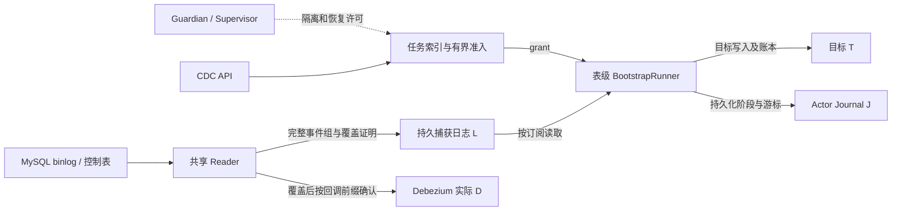
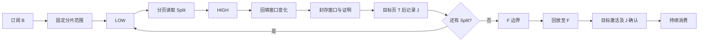

# 常驻 CDC 主流程与状态边界

本文记录重构前后的现有实现，不代表所有窗口都已完成端到端验证。版本与实验边界见 [CDC 系列验证汇总](../articles/cdc-design/README.md)。

`SharedMySQLCapture` 对原始回调做解码、控制事件绑定、完整组装配和持久化，只有 L 覆盖后才按回调前缀调用提交句柄；D 由 Debezium 保存，不能用 T 或 J 代替。回调内部分组和回调的边界不同，跨回调事件不能提前确认。

B 是捕获订阅边界；LOW/HIGH 界定一次初始化窗口；F 是全量完成后的回放边界。未封存窗口失去读视图时沿用已记录范围重读；封存结果必须经过证明校验。实时回放按完整组提交目标 T 后再更新 J；这是表级交付顺序，与 Reader 的原始回调 ACK / D 是不同的边界。

资源释放或提交结果未知时保留 UNKNOWN，不能仅凭线程停止或超时释放配额。已有证明预算、日志回收、DDL、70 万真实表及 guardian 故障覆盖的限制仍以各实验报告为准；本次结构整理不改变这些协议和结论。
