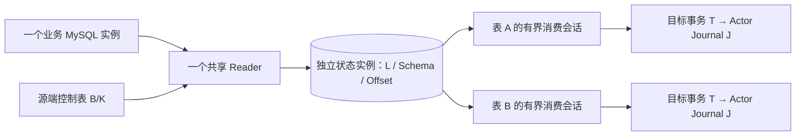

# 一：70 万张表如何常驻——从 Pekko 的执行模型理解 CDC 的资源优势

> **2026-10-25 状态更新：**下文保留原版本的源码分析与历史实验。新增共享捕获路径、真实故障结果及当前限制见文末“共享捕获阶段一”部分和[本轮证据报告](../../experiments/2026-10-25-shared-capture/README.md)。旧单表路径的历史限制不能直接套用到新增路径；新增路径也不代表 LOW/HIGH 初始化已经完成。

上一家公司有 70 多万张表，需要长期管理数据同步任务。对这样的系统，启动一次同步并不难，难的是让大量任务持续存在：每张表有自己的配置、进度和异常，能够单独暂停、恢复；多数任务没有控制操作时，又不应各自占着一条执行线程。

这正是我考虑 Pekko 的原因。**Actor 最有价值的地方，是把任务的身份、状态和执行线程分开。** 一张表的任务可以长期存在，但只有处理消息时才借用 Dispatcher 的线程。理解这句话，必须继续追问：线程怎样借出和归还？两个线程为什么不会同时修改同一个 Actor？没有消息时究竟省掉了什么？当 Actor 启动了一个永不结束的 CDC Stream，这些优势还剩多少？

本文沿 Pekko 1.1.3 和 `pekko-reference` 的实际调用链回答这些问题。70 万表是业务背景，尚未做这个规模的容量测试。本轮补做的是本地执行机制实验；文中分别标明**源码结论、模型推导、实验结果和未验证边界**，不把机制成立换算成容量达标。

版本固定为 Pekko **1.1.3**，上游提交 `38facf752b4e7d5fb43ed7c671eb91888b41bd10`；本篇 Actor 与资源机制引用 `d88ec80f2a7166cfdaddf1284cc268a68bc62e28`；新增完整组生产路径固定为 `65ab541`。后者保留本文讨论的 Actor、Bridge 阻塞和共享池配置，不应把恢复改造当成资源扩容。本轮机制实验运行时工作区 HEAD 为 `72088fe`，相关生产源码与该公开基线一致。实验使用 Scala 2.13.12、JDK 17；[完整实验材料](../../experiments/2026-10-18-actor-execution/README.md)记录环境和输出。

## 1. 70 万个任务，究竟是哪一种“同时存在”

先考虑一张冷表：它一天可能没有数据变化，但我们仍然希望知道它是否启用、最近的进度在哪里、失败后由谁恢复。这个任务没有消失，只是暂时没有需要 CPU 执行的工作。

如果用一个循环代表一张表，循环不断检查状态，任务数量会直接变成等待者数量。若每个循环还绑定线程、连接和日志读取器，资源消耗会随表数增长。把循环放进 Actor 并不会改变这一点。真正需要解耦的是以下几种数量：

| 符号 | 含义 | 与 70 万表的关系 |
|---|---|---|
| N | 有逻辑身份、配置和恢复记录的任务总数 | 假设一表一任务时，约为 70 万 |
| R | 当前进程或集群中驻留内存的任务 Actor 数 | 可以小于 N，也可能接近 N |
| A | 某一时刻有消息待处理或正在处理的 Actor 数 | 通常小于 R；突发操作时可以接近 R |
| P | 用于这些消息处理的执行线程预算 | 不需要等于 R 或 N |
| C | 正在运行的日志捕获实例数 | 由捕获方式决定，不能从表数直接推出 |

这里“活跃”专指 Actor 消息处理，不代表表正在产生数据。一个 Actor 启动了 Stream 后，即使邮箱长期为空，Stream 仍可能不断读取和写入。

Pekko 的第一层优势是允许 `R ≫ P`：大量 Actor 共享少量线程。Sharding 与钝化提供另一层可能性：让 `N ≫ R`，大量逻辑任务不必始终保留实体对象。两层优势的成立条件不同。前者来自消息调度；后者依赖实体生命周期、持久化状态和业务唤醒机制。

这也解释了为什么“单个 Actor 很轻”不足以判断 70 万表是否合适。需要分别算 Actor 状态、待处理消息和持续采集资源，不能只数 ActorRef。

## 2. 一条消息如何借到线程

从项目中的 `context.self ! AdvanceCheckpoint(...)` 这类消息出发，可以沿着 Typed API 一直走到执行器。Pekko 1.1.3 的 [`ActorRefAdapter.tell`][ref-adapter] 将消息交给底层 classic ActorRef；本地 ActorRef 再通过 ActorCell 把消息交给 Dispatcher。

关键动作发生在 [`Dispatcher.dispatch`][dispatcher]：先将 Envelope 放入接收方的 Mailbox，再尝试把这个 Mailbox 注册到执行器。

```text
ActorRef.tell(message)
  → ActorCell.sendMessage(envelope)
  → Dispatcher.dispatch(cell, envelope)
      → mailbox.enqueue(envelope)
      → registerForExecution(mailbox)
          → 如果成功取得 Scheduled 标记
              executor.execute(mailbox)
```

注意执行器接收的对象：**它调度的是 Mailbox，不是为每条消息创建一条线程，也不是为每个 Actor 永久绑定一条线程。** 一个已经进入调度状态的邮箱又收到消息，发送方只需要入队；后续消息可以由同一轮邮箱执行处理。

线程真正开始执行时，会调用 [`Mailbox.run`][mailbox]。它先处理系统消息，再处理普通消息。普通消息经 `ActorCell.invoke` 进入 Typed 的 [`ActorAdapter`][actor-adapter]，最终解释当前 Behavior。Behavior 返回后，线程才有机会处理下一条消息或归还执行权。

```text
                         同一个 Dispatcher 的执行器
                         ┌────────┬────────┐
                         │线程 P1 │线程 P2 │
                         └───┬────┴───┬────┘
                             ↓        ↓
本轮可运行邮箱：          表 A 邮箱   表 B 邮箱
下一轮可能执行：          表 C 邮箱   表 A 邮箱

没有消息的表 D、E、F：对象和状态可以仍在内存中，但不占有上述线程。
```

**源码结论：**Actor 的长期身份与线程的短期执行权相互独立。同一个 Actor 的不同轮次可以由不同线程处理。因此，线程本地变量不能用来保存它的业务身份；反过来，Actor 的状态也不需要靠一条始终存活的专用线程才能存在。

这个机制还有一个常被忽略的收益：普通业务消息的到达直接触发邮箱调度，不需要为了发现这些消息而定时遍历全部 N 个 Actor。空邮箱不会因为“这个任务仍然存在”就不断执行用户处理函数。系统定时器、集群维护和业务自己创建的轮询，当然仍有各自的成本。

## 3. 共享线程，为什么同一个 Actor 不会被并发执行

如果只是“消息进队列，然后把队列交给线程池”，会立即遇到竞争：两个发送线程同时发现邮箱有消息，都提交一次任务，两个工作线程就可能同时调用同一个 Actor。

Pekko 用 Mailbox 状态中的 `Scheduled` 位阻止这种情况。[`setAsScheduled`][mailbox] 先读取状态，再通过 CAS 更新；只有成功设置这个标记的一方能够提交执行任务。状态已经带有 `Scheduled` 时，新的注册不会再提交同一个邮箱。

把与普通消息相关的过程简化为：

```text
未调度 + 新消息
  → 入队
  → CAS 设置 Scheduled
  → 提交 Mailbox
  → 顺序调用消息处理函数
  → 清除 Scheduled
  → 再检查邮箱，必要时重新注册
```

这个简化省略了关闭、挂起和系统消息分支。它解释的是正常存活的本地 Actor，不能拿来证明网络传输可靠或进程崩溃后消息不丢失。

### 3.1 第一个不变量：同一 Actor 的普通消息处理函数不重叠

**源码推导。** 在邮箱开放、执行器正常接受任务的条件下，成功取得调度标记的执行路径才能处理普通消息；标记清除发生在本轮消息处理结束之后。因此，同一个 Actor 的两个普通消息处理函数不会同时运行。

这里的承诺严格限制在消息处理函数内。处理函数若启动一个 Future，并在 Future 中直接修改 Actor 持有的可变集合，那个修改已经越过串行化边界。Actor 不会把任意异步回调也自动变成串行操作。

同样，串行处理不会替代业务版本校验。旧执行的 Future 可能晚于新执行完成；它发回的结果虽然排队处理，仍可能属于过期的 executionId。项目在处理 `EngineFinished` 和 `EngineCrashed` 时检查执行身份，解决的是这个问题，而不是线程互斥问题。

### 3.2 第二个不变量：退出本轮执行时，不因入队竞争漏掉唤醒

设线程 X 正准备结束邮箱执行，线程 Y 同时发送新消息。危险窗口是 X 已经决定结束，但还没释放调度状态。

[`Mailbox.run` 的 `finally`][mailbox] 依次执行 `setAsIdle()` 和 `registerForExecution(...)`，正是为了覆盖这个窗口：

| 新消息到达时间 | 发送方可能看到什么 | 后续由谁触发执行 |
|---|---|---|
| X 清除标记之前 | 邮箱仍是 Scheduled，Y 不重复提交 | X 清除后重新检查，发现消息并注册 |
| X 清除标记之后 | 邮箱可以重新取得调度权 | Y 或 X 的重新检查取得标记；另一方不会重复提交 |

这是一条并发时序推理，不是“实验跑了几万条没丢，所以永远不会丢”。它还依赖邮箱的并发入队和可见性语义，以及 Actor 没有停止、执行器没有持续拒绝任务。Dispatcher 源码明确存在执行器拒绝提交后的失败分支。

它证明的是**本地调度不因这个竞争窗口遗漏执行机会**，不证明业务消息已经持久化，也不证明跨节点 exactly-once。

### 3.3 一轮执行多久，决定了冷任务需要等多久

Pekko 1.1.3 的默认 Dispatcher `throughput` 为 5。Mailbox 每轮最多处理对应数量的普通消息，之后释放调度标记并重新竞争。较大的值可以摊薄调度开销，较小的值让其他邮箱更频繁地参与执行权竞争。[默认配置][actor-config]

但这是**协作式让出执行权**。`throughput = 1` 不会在一个处理函数执行到一半时抢走线程；时间预算的检查同样发生在消息处理返回之后。一个 JDBC 调用阻塞 30 秒，这条线程就可能被占住 30 秒。

所以 Actor 的轻量性有一个具体前提：消息处理应当短小，把耗时工作交给合适的异步通道，完成后再以消息返回。这个前提可以沿源码检查，也能通过实验破坏；它不是风格建议。

## 4. 把机制落到实验：一万个 Actor 共用两条线程

本轮使用真实 Pekko 1.1.3 Typed Actor，配置一个固定两条线程、`throughput = 5` 的 Dispatcher。创建 10,000 个普通 Actor，保留它们的引用，每个发送 4 条带顺序号的消息，共 40,000 条。

探针同时记录实际进入处理函数的线程名、全局处理并发数、单个 Actor 的重叠次数和顺序错误。顺序只检查本实验中单一发送线程向同一个 Actor 依次发送的消息，不推导多发送方之间的全局顺序。

**实验结果：**本次运行实际得到以下数据，[原始输出](../../experiments/2026-10-18-actor-execution/result.txt)保留了线程名和断言结果。

| 检查项 | 结果 |
|---|---:|
| 保持存活的 Actor | 10,000 |
| 完成处理的消息 | 40,000 |
| 实际进入处理函数的线程数 | 2 |
| 观察到的全局最大处理并发 | 2 |
| 单 Actor 处理重叠次数 | 0 |
| 本实验发送条件下的顺序错误 | 0 |
| 无新消息的 300 ms 内新增处理次数 | 0 |

该组实验检查了“Actor 数量远大于执行线程数”这条运行路径，没有测量吞吐上限。最后一项只统计用户消息处理次数，不是整个 JVM 的 CPU 使用率。

随后增加一个受控反例：两个 Actor 各自进入阻塞处理函数，用门闩占住两条线程；再向同一 Dispatcher 上的第三个 Actor 发消息。门闩释放前后，分别检查第三个处理函数能否进入。实际结果是：两条线程被占住后的 300 ms 观察窗口内，第三个处理函数没有进入；释放门闩后，第三条消息完成处理。

这个反例把两个事实放在一起：大量空闲 Actor 可以共享线程；少量阻塞 Actor 也能耗尽这些线程。决定资源消耗的不是 Actor 的名字，而是处理函数及其启动工作的实际行为。

实验没有启用 Cluster Sharding、Journal 或 MySQL，也没有测量每个 Actor 的堆内存、P99 延迟和故障恢复时间。因此它只支持本地调度机制，不支持“一万个持久化 CDC 任务已验证”，更不能线性外推到 70 万表。

## 5. 从执行模型推导资源收益，而不是给 Actor 编一个内存常数

设第 i 个 Actor 的消息到达率为 λᵢ，平均一次处理占用工作线程的时间为 cᵢ。先假设处理函数不会无限阻塞，负载长期平稳，且忽略调度与其他系统工作。

在这个简化模型中，共享线程池不持续积压，至少要求：

```text
Σ(λᵢ × cᵢ) < P
```

同一个 Actor 的普通消息不能并行处理，因此每个热点实体还需要满足：

```text
λᵢ × cᵢ < 1
```

这两条只是必要的容量约束，不是延迟保证。突发到达、长尾处理时间、Journal 等待和上下游瓶颈，都可能让平均值看起来充足的系统积压。某个实体过热时，增加其他节点也不会自动把它的单个消息处理函数拆开并行。

**模型推导：**当 N 很大，但消息稀疏时，`Σλᵢ` 可以很小，P 不必跟着 N 增长。纯粹举例，70 万个任务若每个平均每天产生一次控制操作，均摊只有约 8.1 次/秒；若每个任务每 10 秒产生一次检查请求，就变成 7 万次/秒。这里计算的是假设的控制流量，不是业务实测，也不包括 CDC 数据量。

这说明，海量任务平台采用消息驱动具有实在的价值：无需为每个冷任务维持一个轮询执行循环。业务若又给每个 Actor 加上高频定时自检，就会主动制造原本可以避免的工作。

内存则需要另一张账：

```text
M ≈ R × h + Σqᵢ + M捕获器 + M快照 + M写入 + M共享元数据 + M运行时
```

h 是某种具体实体的驻留成本，qᵢ 是该实体邮箱、stash 和相关待处理请求的实际字节数。h 包括 Behavior、业务状态和关联对象，不能用一个空 Actor 的测量值代表持久化工作流；qᵢ 也不能只按消息条数估算，一条消息可能携带很大的工作流定义或批次。

Actor 的第一层收益主要在**执行线程不随驻留实体逐个增长**，以及不要求为每个空闲任务保留专属执行循环。驻留状态仍然消耗堆内存，数量大时仍会影响 GC。即便成功钝化了实体，全表目录、Schema 索引、Journal 和数据库元数据也未必随之缩小。

此外，默认 Mailbox 无界，持续积压会把“线程不够”转化成“内存增长”。Pekko 的有界 Mailbox 在无法接收时存在进入 dead letters 的路径；它本身不提供业务批次确认协议。[Mailbox 实现][mailbox-queue] 因而 CPU 复用、内存限额和可靠背压，是三个需要分别成立的条件。

## 6. 逻辑身份可以常驻，Actor 对象可以按需存在

共享线程解决 `R ≫ P`，还没有解决 R 本身太大。接下来需要区分三个对象：逻辑实体 ID、正在运行的 Actor，以及保存它恢复状态的持久化记录。

项目 [`WorkflowSharding`][project-sharding] 使用 workflowId 作为实体 ID，通过 `floorMod(hashCode, numberOfShards)` 得到 shardId，再由 Sharding 把消息路由到承载这个 shard 的 worker 节点。上游 [`Shard.getOrCreateEntity`][shard-create] 在实体不存在时才创建子 Actor，并登记实体引用。

```text
workflowId
  → shardId
  → 承载 shard 的节点
  → 本地实体 Actor
  → 此刻处理消息的 Dispatcher 线程
```

这几个映射的生命周期不同。实体迁移后，逻辑 ID 可以不变，节点和线程都可以改变。项目当前路由的是完整工作流；它没有把一个工作流中的 Source、Transform、Sink 自动拆到不同节点执行。

因此，100 个 shard 不是 100 条线程，也不是 100 个 CDC Reader。如果 70 万个实体均匀分布在 100 个 shard 中，平均每个 shard 约有 7,000 个实体；这只是数量上的算术。实体负载可能不均匀，按数量分散不等于按变更字节率分散，shard 迁移还会同时影响一组实体。

### 6.1 钝化释放的是对象，恢复的是状态

自动钝化可以根据实体活动决定停止某个 Actor。Sharding 的停止协议会在钝化过程中缓冲后续消息，等实体停止后按需重新创建；它不是把正在执行的 Java 调用栈保存到磁盘。[`Shard` 的停止与缓冲路径][shard-passivate]

若实体使用 Event Sourcing，新 Actor 通过快照和 Journal 重建业务状态。由此可以保留逻辑任务，却不一直保留原来的实体对象。不过，普通 Actor 不会因被 Sharding 管理就自动拥有持久化业务状态；重新创建与恢复原状态是两件事。

还有一个业务约束：没有消息到达，就未必有人唤醒已钝化实体。如果每张表唯一的日志读取器随 Actor 一起停止，而外部又没有共享捕获器或其他触发机制，钝化之后的新数据由谁发现？“冷表按需唤醒”必须存在真实的唤醒路径，不能只画一条箭头。

### 6.2 当前项目的空闲钝化实际上没有启用

项目基础配置同时设置了：

```hocon
passivate-idle-entity-after = 30m
remember-entities = on
```

开发配置把空闲时间改为 5 分钟，生产配置改为 1 小时。仅看配置注释，很容易以为它们都在自动清理冷实体。

但 Pekko 1.1.3 的 [`PassivationStrategy.apply`][passivation-settings] 先检查 `rememberEntities`：开启时直接返回 `NoPassivationStrategy`，之后才是空闲策略和容量策略的选择。

**源码结论：当前三套配置都关闭了自动钝化。** 这里关闭的是 Sharding 的自动策略，不是禁止应用显式请求钝化或停止。

本轮也实际解析了这三套配置，调用 1.1.3 的 Sharding settings 构造逻辑读取有效策略；再仅将 `rememberEntities` 改为 false，作为对照。

| 配置文件 | 声明的空闲时间 | remember entities | 实际策略 | 仅关闭 remember 后 |
|---|---|---|---|---|
| application.conf | 30 分钟 | true | NoPassivationStrategy | IdlePassivationStrategy |
| application-dev.conf | 5 分钟 | true | NoPassivationStrategy | IdlePassivationStrategy |
| application-prod.conf | 1 小时 | true | NoPassivationStrategy | IdlePassivationStrategy |

这是**配置解析实验结果**，未启动集群等待 30 分钟，也不代表某个部署一定采用这些文件。环境变量或部署覆盖配置仍需另行核对。

Remember Entities 的用途是记住需要重新启动的实体集合。它解决“shard 恢复后，哪些实体应自动回来”，业务 Journal 解决“某个实体回来后，状态是什么”。这两份状态不能互相代替。代价是：曾经活跃并被记住的实体可能需要成批恢复，不能把它描述为“所有冷实体只在下一条业务消息到达时恢复”。

上游默认 `entity-recovery-strategy = all`，项目当前没有覆盖；`constant` 策略可以分批启动，但限速作用于每个恢复中的 shard，而不是整个集群。[恢复配置][sharding-config] 实体启动节奏也不等于 Journal 或数据库可承受的恢复吞吐。本文没有压测这个恢复过程。

## 7. 项目中的 Actor 如何管理一个长期 CDC 执行

回到 `EventSourcedWorkflowActor`。它没有在消息处理函数中一直等待 CDC 完成。[`runEngine`][project-actor-run] 启动 Engine，取得 Future，然后通过 `context.pipeToSelf` 把完成或失败结果转换成消息。

其执行关系是：

```text
处理启动命令 → 启动异步 Engine → 当前消息处理返回
                                  │
                                  ├─ Stream 持续运行
                                  └─ 完成或失败 → 给 Actor 发消息 → 再借线程处理
```

**源码结论：**整个 CDC 任务运行多久，与这次 Actor 消息占用线程多久，没有一一对应关系。Actor 可以在任务运行期间继续管理自己的状态；数据流的生命周期由 Engine、Future 和 KillSwitch 等对象维持。

持久化也采用状态机方式。Pekko 的 [`Running.PersistingEvents`][persistence-running] 收到普通命令后将其暂存，等待 `JournalResponse` 再推进状态和后续动作。这条等待路径不要求为每个持久化 Actor 保留一个阻塞在 Journal 确认上的专属线程。实际数据库驱动和 Journal 插件仍然需要自己的执行资源，等待期间的命令也会形成 stash 成本。

这一点很适合大量独立任务：每个任务都可以有串行的状态转换和独立的持久化身份，执行资源仍然共享。相比自行维护“任务 Map + 锁 + 回调 + 恢复状态”，Pekko 把串行状态机、异步消息和恢复生命周期放到了同一个编程模型中。

不过，异步工作必须回到身份与生命周期的约束里。项目恢复完成后，依据持久化的 executionId 重新启动可恢复执行；`Stop` 和 `PostStop` 又会取消当前 Engine。[恢复与停止逻辑][project-actor] 这说明恢复的是执行描述和进度，不是恢复旧线程；也说明 Actor 的停止会影响数据采集。

因此，不能把上一节的发现直接处理成“关闭 remember，打开 idle 就好了”。Shard 在经由它转发消息时调用 `entityTouched`；项目的 Engine 完成消息和 Checkpoint 请求通过 `context.self` 返回，不经过这条转发路径。[活动更新时间][shard-deliver] 如果改成按 Sharding 消息判断空闲，就可能出现 Actor 缺少外部控制消息、Stream 却仍然忙碌的情况。钝化随后触发 `PostStop`，会取消执行。

这是结合两段源码得到的**条件性推演**：当前自动钝化关闭，所以本文没有声称已经观察到“生产中 CDC 被空闲回收”。它解释的是为什么生命周期不能只靠一个超时配置决定。

## 8. 走出 Actor 之后，资源为什么又按任务数增长

Actor 层已经共享线程，是否意味着当前项目可以低成本常驻大量 CDC 任务？必须继续向下看。

[`MySQLCdcSourceNode.createBatches`][project-source] 使用 `Source.unfoldResourceAsync` 创建资源、读取批次和关闭资源。其中读取逻辑是：

```scala
read = resource => Future(resource.nextBatch())(blockingEc)
```

API 名称中的 Async 容易让人忽略括号内的工作。Future 只表示调用方异步等待结果，并不保证 `nextBatch()` 不阻塞执行它的线程。

### 8.1 每个运行中的 Engine 都有独立 runner

[`RealDebeziumEngineAccess`][project-engine-access] 为每个实例创建 `Executors.newSingleThreadExecutor`，然后把 `created.run()` 提交进去。只要这个 Engine 仍在运行，这个 runner 就是一项长期资源。这里描述的是至少一条外层 runner 线程，不是 Debezium 内部所有线程的上限。

当前 Source 按配置的一张表设置 `table.include.list`，创建自己的 `CdcResource`；offset 与 Schema history 也按 connectorId 隔离。[连接器属性][project-source-properties] 因而，如果用当前路径为每张表启动一个工作流，运行中的 Engine 数量会随这些任务增长。Actor 的线程复用不会消除 Engine 自己创建的线程，也不会自动合并数据库连接和 Schema 缓存。

### 8.2 等待一批数据，也可能长期占着共享线程

`CdcResource.nextBatch()` 调用 [`DebeziumBatchBridge.take`][project-bridge]。Bridge 使用容量为 1 的 `ArrayBlockingQueue`；无批次时，`queue.take()` 会阻塞当前线程。

当前调用链可以分成三种执行资源：

```text
Actor Dispatcher
  处理启动、状态转换、Checkpoint 与执行结果消息

workflow.jdbc-dispatcher
  Future(nextBatch) → bridge.take → 阻塞等待批次
  Sink commitBatch、Source acknowledge、部分创建与关闭操作也提交到这里

每个 Debezium Engine 的独立 runner
  运行 Engine；批次回调经过 Bridge 交给 Stream
  Bridge.publish 等待批次完成确认
```

项目 [`WorkflowExecutionEngine`][project-batch] 将 Source 和 Sink 的这些操作交给同一个 `jdbcBlockingEc`。基础配置的固定线程池大小为 8，开发为 4，生产为 16。

**源码推导：**如果 8 个暂时没有数据的读取占住基础配置的 8 条线程，同一池中后来提交的 Sink 操作、ACK 或其他工作就只能排队。增加 Actor 数量不会让这 8 条线程变空闲；把队列容量改小也不会改变 `take()` 的阻塞性质。

本轮用项目当前 `DebeziumBatchBridge.scala` 重新编译，创建 8 个空 Bridge，把 8 次 `take()` 提交到真实 Pekko JDBC Dispatcher。实验先检查线程栈，确认所有 8 条线程都位于 `ArrayBlockingQueue.take`，再提交一个代表“同池后续工作”的 sentinel。最后从测试主线程关闭 Bridge，观察工作线程能否释放。

**实验结果：**8 条读取线程的阻塞栈全部确认；同池 sentinel 在随后 300 ms 内未执行，另一个 Dispatcher 上的控制 Actor 可以响应；测试主线程关闭 8 个 Bridge 后，读取等待退出，sentinel 随后执行。

该组件实验验证的是共享执行器的饥饿条件。sentinel 不是实际 Sink 提交；没有启动 MySQL、Debezium 或完整工作流，不能将结果写成“8 个真实 CDC 作业必然死锁”。完整作业是否进入这个窗口，还取决于启动顺序、下游 demand、源端回调和关闭路径。

尤其值得注意的是：Source 的 close 也通过同一阻塞池提交。测试从外部直接关闭 Bridge，证明的是存在可解除的等待；它没有证明真实 Stream 取消时一定能沿原路径及时解除。这个取消窗口仍需要完整作业实验。

### 8.3 有界批次不等于所有资源都有界

Bridge 的 `publish` 会等待批次确认，Engine 中的 `mapAsync(1)` 又限制每条 Stream 同时推进的批次处理。这些机制提供了局部流控，避免毫无节制地向下游提交批次。[批次处理顺序][project-batch]

但它们约束的单位不同：Bridge 限制自身队列，`mapAsync(1)` 限制单条流的处理并发，固定线程池限制同一时刻可运行的阻塞操作。W 条 Stream 仍可能各自拥有一份批次、Schema 和 Engine；一个批次的字节数也不固定。局部有界不能直接相加成一个固定的全局内存上限。

更重要的是，资源共享与可靠确认相互影响。当前顺序是 Sink 提交、Actor Checkpoint 持久化、Source ACK。等待确认会拉长资源持有时间，却承担着恢复协议的职责。若为了释放资源而提前 ACK，问题就从调度变成了故障后能否重放。下一篇讨论的 T/J/D，正是这个边界。

### 8.4 完整组恢复增加了什么资源成本

**源码结论：**新增 [MySQLCdcGroupAssembler][group-assembler] 保留原始回调与至多一个尾部半组；完整组经 T/J 覆盖后，才在有序回调路径确认原始前缀。源码限制待确认回调不超过 2 个、记录数不超过配置上限，保留内容采用 16 MiB 编码体积预算，并清除已无回调引用的覆盖集合。这不是 SDK 队列、解码峰值或整个 JVM 的堆上限；每个运行中的 Source 仍有自己的装配状态。

目标还新增组账本写入与完整成员证据存储，混合旧/新组恢复时也要查账本。这些成本换来不依赖回调划分的恢复依据，但本次没有测量其吞吐、内存斜率或海量表累积成本。

**真实实验结果：**三组真实 Source/Actor Journal/Sink 恢复均完成 64 行、6 字段全量对账，已提交组没有重复审计副作用。它没有启动 70 万表，没有修复共享 JDBC 池的空读取占用，也没有改变 remember/钝化策略。单个 Source 取消等待的单测，不等于大量真实作业同时饥饿时关闭路径已经验证。[实验范围](../../experiments/2026-10-19-group-recovery/README.md)


## 9. 70 万表场景下，Actor 优势成立的条件

到这里，可以给出比“Actor 天然适合海量任务”更精确的判断。

**第一，任务数量远大于同时需要执行的控制工作时，Actor 具有明确的执行资源优势。** 串行状态机提供每个任务独立的状态边界，共享 Dispatcher 让执行线程主要由并发工作量决定，而不要求每个逻辑任务独占线程。这个机制已经由源码和本地实验支持。

**第二，Actor 的等待方式决定优势能否保留。** 等消息、等待 Future 以消息返回、等待 Journal 响应，都可以让 Actor 释放执行线程。把无限等待写进消息处理函数，或在外围为每个任务创建阻塞读取器，则会重新引入与任务数相关的资源。

**第三，降低驻留内存还需要一层生命周期机制。** Sharding 能根据 ID 找到或创建实体，持久化能重建状态，钝化能释放对象。但当前 remember 配置关闭自动钝化，业务 Actor 停止又会取消 Engine。因此，当前代码不能宣称已经实现“70 万个逻辑任务，只有少量实体驻留”。

**第四，昂贵资源必须按实际工作域计费。** 如果一组表可以共享源日志读取，捕获资源有机会按捕获域 C 增长；如果仍为每表创建独立 Engine，它就按运行表任务数增长。Pekko 提供管理这些实体的工具，不会自动替应用改变连接器拓扑。共享读取还必须保留慢表隔离和可重放进度，这属于后续协议工作。

可以把适用条件与反例放在一起看：

| 优势依赖的条件 | 破坏条件的反例 | 发生变化的资源 |
|---|---|---|
| 冷任务不反复制造无效工作 | 每表高频轮询、自检、心跳 | 消息率、CPU、Journal 写入 |
| 处理函数快速归还执行权 | 在 handler 中同步等待 JDBC | Dispatcher 线程、其他任务延迟 |
| 异步操作不长期耗尽同一池 | 空 Reader 的 `take()` 占满共享池 | Sink、ACK 和关闭操作排队 |
| 实体可以安全停止并被唤醒 | 停止实体同时停止唯一捕获器 | 新变更发现与恢复时效 |
| 状态与待处理数据受控 | 无界邮箱、巨型批次、每实体大缓存 | 堆内存、GC 和恢复时间 |
| 捕获资源能够复用 | 一表一个持续 Engine | 线程、连接、Schema/offset 状态 |

这些反例没有否定 Actor 的价值。它们划出了价值来自哪一层：**海量身份和生命周期可以用轻量、串行、可恢复的实体表达；持续数据处理的资源仍需独立建模。** 对有大量长期任务、且需要精细到单任务控制的业务，这是很有吸引力的基础。

也不能据此推导 Pekko 一定比 Flink CDC 更省。Flink CDC 并不要求一张表对应一个独立 Flink 作业。合理比较应固定相同的表集合、变更负载、延迟、恢复目标和资源复用方式，再比较控制粒度、资源曲线和协议维护成本。第五篇会承担这个比较；本文尚无同负载性能对照。

## 10. 本文已经证明什么，还没有证明什么

本文的中心结论是：**Pekko 可以把大量任务的长期身份，与少量线程的短期执行解耦；当前项目的 Actor 控制层已经采用这种方式，而 CDC 读取层仍有按运行任务增长的独立线程和阻塞等待。** 这比“换成 Actor 就能承载 70 万表”更有用，因为它能明确指出资源收益的来源，以及实现中需要继续检查的边界。

| 问题 | 证据层级 | 本文支持的结论 | 没有覆盖的结论 |
|---|---|---|---|
| 大量实体能否共享少量执行线程 | 固定版本源码 + 本地 Typed Actor 实验 | 普通消息通过邮箱调度，实体不要求独占线程 | 70 万个持久化实体的内存与延迟 |
| 同一实体如何串行、如何避免退出时遗漏唤醒 | Mailbox/Dispatcher 源码推导 + 有限运行检查 | 正常本地调度路径的互斥与重新注册机制 | 网络可靠传输、崩溃后消息恢复 |
| remember 与自动钝化是否同时生效 | 源码 + 三套配置解析实验 | 当前配置选择 NoPassivationStrategy | 线上实际配置、集群钝化和迁移运行结果 |
| 空读取是否可能耗尽共享线程池 | 项目源码 + 真 Bridge / 真 Dispatcher 组件实验 | 受控窗口下，同池后续工作无法进入执行 | 完整 MySQL 作业是否进入同一窗口、取消是否及时 |
| 每表 Engine 是否仍有独立执行资源 | 项目源码 | 每个启动的实例有外层单线程 runner | Debezium 总线程数、连接数与容量曲线 |
| Journal 与目标提交能否恢复一致 | 旧协议反例 + [完整组生产恢复](../../experiments/2026-10-19-group-recovery/README.md) | 新协议拆批、合批、主键跨回调的 T 已提交/J 未持久化样本通过 | Sharding、70 万表、所有故障窗口的端到端保证 |

上面的 Actor/Dispatcher 机制实验没有部署集群，也没有重跑 MySQL。后续 `65ab541` 已接入完整组生产恢复，并完成新的真实 MySQL 实验；它支持的是指定故障窗口，不改变本文的规模判断。

下一篇：[一次提交，三份进度——沿源码推导 Pekko CDC 的恢复契约](02-source-and-recovery-contract.md)。它要继续回答：当控制状态、目标提交和源确认分别持久化时，哪些顺序可以保留，哪些崩溃窗口必须靠重放协议解决。

2026-10-19 又补充了[身份与 ACK 边界](../../experiments/2026-10-19-source-record-identity/README.md)及[真实 Engine/Bridge 跨回调探针](../../experiments/2026-10-19-deferred-ack/README.md)。后者在测试装配器内避免了半组进入等待，但没有改变生产 Bridge 的等待行为或共享池配置，也没有测量 Actor 容量。这些源侧结果不扩大本篇的资源结论。


## 附录：沿着本文结论读源码

建议按执行问题阅读，避免先被包目录淹没：

| 要回答的问题 | 固定版本入口 | 阅读重点 |
|---|---|---|
| Typed 消息如何进入调度器 | [ActorRefAdapter][ref-adapter] → [Dispatcher][dispatcher] | 入队与注册调度分开，执行对象是 Mailbox |
| 同一 Actor 为什么不并发执行 | [Mailbox][mailbox] | Scheduled CAS、run finally、throughput 检查位置 |
| 普通消息怎样进入 Behavior | [ActorAdapter][actor-adapter] | interpretMessage 与 Behavior 转换 |
| 实体何时创建、停止和重新创建 | [Shard][shard-create]、[钝化路径][shard-passivate] | 实体状态、缓冲、Terminated 后的处理 |
| 配置实际选择哪种钝化策略 | [ClusterShardingSettings][passivation-settings] | rememberEntities 的优先分支 |
| Journal 等待是否占着 Actor 线程 | [Running.PersistingEvents][persistence-running] | stash、JournalResponse、side effects、unstash |
| 异步 Source 什么时候发起读取 | [UnfoldResourceSourceAsync][unfold] | onPull 调 readData，Future 完成经异步回调返回 |
| 本项目到底在哪些地方阻塞 | [Source][project-source] → [Bridge][project-bridge] → [EngineAccess][project-engine-access] | Future 的 ExecutionContext、queue.take、completion.get、独立 executor |

上游源码清单及 SHA-256 见[版本清单](../../experiments/2026-10-18-actor-execution/source-manifest.json)；探针、运行方式、输出与环境见[实验材料](../../experiments/2026-10-18-actor-execution/README.md)。这份清单用于复核版本，不表示每个源码文件的所有行为都经过运行验证。

[ref-adapter]: https://github.com/apache/pekko/blob/38facf752b4e7d5fb43ed7c671eb91888b41bd10/actor-typed/src/main/scala/org/apache/pekko/actor/typed/internal/adapter/ActorRefAdapter.scala#L35
[actor-adapter]: https://github.com/apache/pekko/blob/38facf752b4e7d5fb43ed7c671eb91888b41bd10/actor-typed/src/main/scala/org/apache/pekko/actor/typed/internal/adapter/ActorAdapter.scala#L134
[dispatcher]: https://github.com/apache/pekko/blob/38facf752b4e7d5fb43ed7c671eb91888b41bd10/actor/src/main/scala/org/apache/pekko/dispatch/Dispatcher.scala#L69
[mailbox]: https://github.com/apache/pekko/blob/38facf752b4e7d5fb43ed7c671eb91888b41bd10/actor/src/main/scala/org/apache/pekko/dispatch/Mailbox.scala#L188
[mailbox-queue]: https://github.com/apache/pekko/blob/38facf752b4e7d5fb43ed7c671eb91888b41bd10/actor/src/main/scala/org/apache/pekko/dispatch/Mailbox.scala#L559
[actor-config]: https://github.com/apache/pekko/blob/38facf752b4e7d5fb43ed7c671eb91888b41bd10/actor/src/main/resources/reference.conf#L561
[shard-create]: https://github.com/apache/pekko/blob/38facf752b4e7d5fb43ed7c671eb91888b41bd10/cluster-sharding/src/main/scala/org/apache/pekko/cluster/sharding/Shard.scala#L1124
[shard-passivate]: https://github.com/apache/pekko/blob/38facf752b4e7d5fb43ed7c671eb91888b41bd10/cluster-sharding/src/main/scala/org/apache/pekko/cluster/sharding/Shard.scala#L914
[shard-deliver]: https://github.com/apache/pekko/blob/38facf752b4e7d5fb43ed7c671eb91888b41bd10/cluster-sharding/src/main/scala/org/apache/pekko/cluster/sharding/Shard.scala#L1072
[passivation-settings]: https://github.com/apache/pekko/blob/38facf752b4e7d5fb43ed7c671eb91888b41bd10/cluster-sharding/src/main/scala/org/apache/pekko/cluster/sharding/ClusterShardingSettings.scala#L804
[sharding-config]: https://github.com/apache/pekko/blob/38facf752b4e7d5fb43ed7c671eb91888b41bd10/cluster-sharding/src/main/resources/reference.conf#L339
[persistence-running]: https://github.com/apache/pekko/blob/38facf752b4e7d5fb43ed7c671eb91888b41bd10/persistence-typed/src/main/scala/org/apache/pekko/persistence/typed/internal/Running.scala#L656
[unfold]: https://github.com/apache/pekko/blob/38facf752b4e7d5fb43ed7c671eb91888b41bd10/stream/src/main/scala/org/apache/pekko/stream/impl/UnfoldResourceSourceAsync.scala#L100
[project-sharding]: https://github.com/Xuxiaotuan/pekko-reference/blob/d88ec80f2a7166cfdaddf1284cc268a68bc62e28/server/src/main/scala/cn/xuyinyin/magic/infrastructure/cluster/sharding/WorkflowSharding.scala#L38
[project-actor]: https://github.com/Xuxiaotuan/pekko-reference/blob/d88ec80f2a7166cfdaddf1284cc268a68bc62e28/server/src/main/scala/cn/xuyinyin/magic/workflow/actors/EventSourcedWorkflowActor.scala#L164
[project-actor-run]: https://github.com/Xuxiaotuan/pekko-reference/blob/d88ec80f2a7166cfdaddf1284cc268a68bc62e28/server/src/main/scala/cn/xuyinyin/magic/workflow/actors/EventSourcedWorkflowActor.scala#L378
[project-source]: https://github.com/Xuxiaotuan/pekko-reference/blob/d88ec80f2a7166cfdaddf1284cc268a68bc62e28/server/src/main/scala/cn/xuyinyin/magic/connectors/mysql/source/MySQLCdcSourceNode.scala#L150
[project-source-properties]: https://github.com/Xuxiaotuan/pekko-reference/blob/d88ec80f2a7166cfdaddf1284cc268a68bc62e28/server/src/main/scala/cn/xuyinyin/magic/connectors/mysql/source/MySQLCdcSourceNode.scala#L355
[project-bridge]: https://github.com/Xuxiaotuan/pekko-reference/blob/d88ec80f2a7166cfdaddf1284cc268a68bc62e28/server/src/main/scala/cn/xuyinyin/magic/connectors/mysql/source/DebeziumBatchBridge.scala#L36
[project-engine-access]: https://github.com/Xuxiaotuan/pekko-reference/blob/d88ec80f2a7166cfdaddf1284cc268a68bc62e28/server/src/main/scala/cn/xuyinyin/magic/connectors/mysql/source/DebeziumEngineAccess.scala#L185
[project-batch]: https://github.com/Xuxiaotuan/pekko-reference/blob/d88ec80f2a7166cfdaddf1284cc268a68bc62e28/server/src/main/scala/cn/xuyinyin/magic/workflow/execution/WorkflowExecutionEngine.scala#L289

[group-assembler]: https://github.com/Xuxiaotuan/pekko-reference/blob/65ab5410c32933d0aa3d23510e6c62252d84009b/server/src/main/scala/cn/xuyinyin/magic/connectors/mysql/source/MySQLCdcGroupAssembler.scala#L34

## 共享捕获阶段一：表的身份不再等于 Reader 的数量

70 万张候选表位于一个 MySQL 实例，而今天只选择五张、明天再增加两张。此时需要长期保留的是订阅身份与恢复事实，不是同时为全部候选表启动 Stream、建立连接或加载 Actor。上一版单表 Engine 的成本分析仍适用于旧 `mysql.cdc` 路径；新增路径开始将捕获与应用分开。

**源码结论：**`SharedMySQLCapture` 管理一个真实 Debezium Engine，捕获数据库内的 Schema 和变更。`MySQLCaptureStore` 在持久化日志 L 中保留选中订阅区间内的完整组；`CapturedLogSource` 按订阅独立分页读取 L。表级工作流 Actor 沿用既有目标组账本和 Checkpoint，不再拥有原始 SDK 回调。



这里有两种不同的资源共享。Actor 的 Dispatcher 复用消息执行线程；共享 Reader 复用源连接、binlog 解码和捕获会话。前者不能推导后者，只有实际拆开 Source 所有权才能减少每表 Engine。L 也不是免费资源：它承担持久写放大、慢表积压、校验和恢复扫描。

当前 Store 最多准入四个并发操作连接；Reader 保留的原始回调最多八个、按 value 序列化内容计最多 16 MiB，SDK 队列另有 16 MiB 配置。消费者单次最多读 1,000 组。这些是实现中的预算，**不是整个 JVM 的内存上界**：Schema History、数据库表发现、Java 对象开销、消费者数量和目标连接池仍在预算之外。现阶段每个活跃消费者使用周期读取，不适合将 70 万个消费者全部激活。

**实验结果：**本轮真实多表样本验证了同一个 Reader 先服务五张表、再加入两张表，以及一张表应用被暂停时另一张表继续提交。七张表每张四行、每行六字段，目标已有可信基线。它证明小样本中的捕获复用与进度分离，不证明 70 万表容量，也不证明“空闲表零成本”。

还有一个影响部署的实测条件。Offset 和 L 与源共用物理实例时，即使写入不同 Schema，事务元数据仍可能交付零行 BEGIN/END；处理这些回调又引发 Offset 写，形成反馈循环。失败材料保留在[报告](../../experiments/2026-10-25-shared-capture/README.md)。当前 profile 要求源与状态服务器 UUID 不同；它服务一个业务源实例，但额外需要状态基础设施。

**未验证边界：**70 万表的 Schema 发现/缓存成本、长期日志增长、活跃消费者准入、自动 GC、共享 Reader 接管和 LOW/HIGH 初始化。下一阶段的资源验收应分别测候选表数、订阅数、活跃消费者数和变更速率，不能再用一个“任务数”掩盖四种不同成本。
