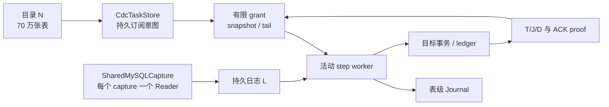
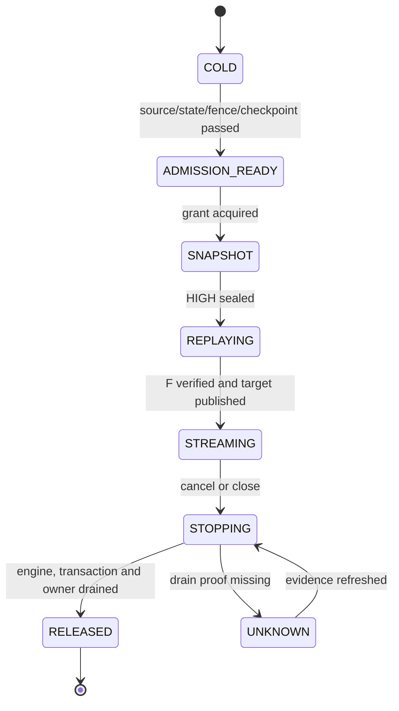
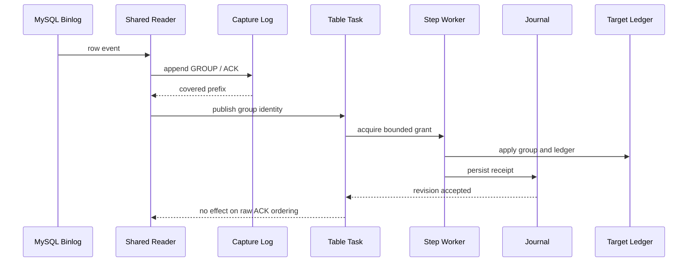

# Pekko CDC 深入解析（一）：70 万张表常驻场景下的 Shared Reader 与有界调度

作者：xuyinyin
[系列导读](README.md) · [Pekko CDC 深入解析（一）](01-why-pekko-for-resident-cdc.md) · [Pekko CDC 深入解析（二）](02-source-and-recovery-contract.md) · [Pekko CDC 深入解析（三）](03-real-mysql-journal-failure.md) · [Pekko CDC 深入解析（四）](04-batch-to-stream-low-high.md) · [Pekko CDC 深入解析（五）](05-pekko-vs-flink-cdc.md)

> **系列主线**：第一篇先拆开 70 万张表的资源模型；第二篇沿一条真实变更解释“被 CDC 接受”的条件；第三篇处理重启、提交未知和 ACK proof；第四篇把全量初始化接到持续流；第五篇再比较 Pekko 与 Flink CDC 的运行时责任。
>
> **源码基线**：`b17b9d1659f923fc256e3b09ad73777ac7acc677`；历史实验按各自材料冻结的版本和切点解释。
>
> **证据口径**：源码结论来自当前仓库调用链；实验结果只对应材料中写明的真实 MySQL、Actor Journal、Sink 和切点；保存材料复算不等于本轮重跑；未验证边界保留为未验证。

## 0 结论

这个问题首先是资源模型问题，其次才是 Actor API 问题。当前实现把三个数量分开：

- `N`：目录中登记的表数，可能是 700,000；
- `S`：已经订阅 CDC 的表数；
- `A(t)`：时刻 `t` 正在执行快照、回放或尾部增量的表数。

一个可工作的长期模型是：每个 capture domain 维护一个共享 MySQL Reader，Reader 将 binlog 事件写入持久化日志 `L`；表级任务只保留自己的 Schema、LOW/HIGH/F 边界、Journal 和目标账本；真正执行数据库读取或 Sink 写入的线程来自有界 step worker 池。

因此，目标不是让 `N` 个表都“活着”，而是让下面的关系长期成立：

$$
\text{source sessions} \approx O(\text{capture domains}) + O(A(t))
$$

$$
\text{step workers} \leq W_{snapshot}+W_{tail}
$$

$$
A(t) \leq W_{snapshot}+W_{tail}
$$

这三条是资源上界模型，不是 70 万张真实表的容量实测。当前仓库有 700,000 条冷任务元数据的分页实验，却没有 700,000 张真实活跃表、吞吐和天级 churn 的证据。



图中最关键的箭头是 `N → C → G → W`：目录记录只进入持久索引，只有拿到 grant 的任务才进入活动执行。Reader 与表级 worker 共享日志，不共享目标进度。

Reader 和表级任务的生命周期可以压缩成一张状态机：



这张图把“目录存在”和“任务执行”分开：`COLD` 只保留任务索引，`ADMISSION_READY` 才获得 Reader 准入，`SNAPSHOT`/`REPLAYING` 才消耗有界执行资源。`UNKNOWN` 不是失败重试的别名，而是释放证明缺失时禁止新 owner 接管的持久状态。

## 1 先把“70 万张表”拆成三个集合

### 1.1 目录不是执行器

如果把每张目录记录直接映射成 Reader，最先耗尽的通常不是 CPU，而是 MySQL 连接、binlog dump 会话、JDBC metadata、Schema 缓存和故障恢复状态。更糟的是，许多表长期没有写入，却仍然占用一套运行时对象。

当前 Runtime 的 SQL 任务表把冷任务和执行中的 grant 分开。`CdcTaskStore` 的 `claim` 只从 `schedulable=TRUE` 且 `due_at<=now` 的任务中取一个候选，并在事务内写入 `pekko_cdc_grants_v1`，同时将任务改为 `IN_USE`。这意味着目录行可以很多，但一次调度只把有限数量的任务带入执行态。

从调用链可以看到，目录规模和执行资源是两层状态；`CdcTaskStore` 的索引和 `claim` 路径支持按 capture、pool、due time 取头部任务，不要求扫描全部表。

在固定版本的真实实验中，冷元数据实验精确插入并遍历 700,000 条任务记录，完整扫描 7,000 页并执行索引检查；实验没有启动 ActorSystem、Shared Reader，也没有创建 700,000 张源表。它只证明在给定索引和配置下，冷目录可分页访问。

这里仍有一个边界：真实 700,000 张物理表、同时发生 DDL、持续 binlog 写入和动态增删表时的 MySQL metadata 成本，仍然没有测量。

### 1.2 一个 capture 对应一个 Reader

当前入口由 `CdcBootstrapKernel.start()` 组装 capture：先打开控制状态库，创建 `MySQLCaptureStore`，再创建一个 `SharedMySQLCapture`。Reader 使用 source 账号连接源库，使用 state 账号连接独立的状态库；启动时明确检查两者不是同一个 MySQL 实例：

```scala
owner = stateConnection()
val stateUuid = query(owner, "SELECT @@server_uuid").head
require(stateUuid != sourceUuid,
  "capture state must use a different MySQL instance: transaction metadata feedback")
```

这里的“共享”是 capture domain 内共享，而不是整个数据库无条件共享一个 Reader。若未来有多个源实例，则每个源实例至少需要一个 capture domain；同一个源实例内部的表可以共享该 domain 的 binlog 会话。

`SharedMySQLCapture.start()` 创建 Debezium Engine，配置 `snapshot.mode=no_data`、事务元数据、Schema history 和有限的队列大小。Engine 的回调由 `accept` 串行接收：

```scala
require(inside.compareAndSet(false, true),
  "concurrent shared callbacks unsupported")
```

它先把原始回调放入有限 `pending` 队列，再逐条处理事件。每一条数据事件必须进入 `MySQLCdcGroupAssembler` 并写入 `L`；只有回调前缀的所有记录都获得持久覆盖，才调用 Debezium 的 `markProcessedAndFinished()`。

从调用链可以看到，Reader 是一个带 owner lease、原始 ACK 前缀和持久 L 的共享组件；回调并发被拒绝，pending 数量和字节数都有上限。一个表的 ACK 不能越过前面仍未覆盖的回调。

这解释了为什么“共享 Reader”不是“只用一个线程”。Reader 的 binlog 会话是共享的，表级初始化和 Sink 写入仍然由独立的 bounded step worker 执行。共享的是捕获顺序和源连接，不是把所有表的业务工作串成一个无限长函数。

### 1.3 从启动入口到第一条事件：实际调用链

把“一个 capture 一个 Reader”写成类图还不够，真正决定边界的是启动顺序。当前实现的同步链可以压缩成下面这段伪代码（省略日志和异常包装）：

```scala
CdcBootstrapKernel.start()
  -> stateIdentity(cfg)
  -> new MySQLCaptureStore(...).initialize()
  -> new SharedMySQLCapture(...)
  -> reader.start()
       -> sourceConnection(): source UUID / ROW / FULL
       -> stateConnection(): state UUID / GET_LOCK(captureId)
       -> readCheckpoint() / recoveryInventory()
       -> factory.create(debeziumProps)
       -> engine.start(handleBatch)
```

`CdcBootstrapKernel.start()` 先检查持久化 source fence 是否仍然被当前配置承认，再为每个 capture 建立 `MySQLCaptureStore` 和 `SharedMySQLCapture`；只有 `reader.start()` 成功后，刷新线程才把 `ADMISSION_READY` 传播给调度层。源码中的顺序是 `CdcBootstrapKernel.scala:131-175`。这意味着调度器看到的“可接纳”晚于 Reader owner、checkpoint、Schema history 和控制表准入，而不是应用进程刚启动就可用。

`SharedMySQLCapture.start()` 又有三个不可交换的检查：

1. 源库必须是同一 `server_uuid`，binlog 必须是 `ROW/FULL`；
2. 状态库必须是不同实例，且 `GET_LOCK('pekko_capture_' + captureId)` 成功；
3. checkpoint、L 的 recovery inventory 和 source fence 通过后，才创建 Debezium engine。

因此，source connection、state owner connection 和 Debezium dump session 的生命周期并不相同。`requestClose()` 首先设置 `stopping`，然后交给 `CaptureReleaseGuard` 依次确认本地 engine 已停止、owner lock 已释放、observer 看到连接和事务排空；`Future[Done]` 返回不能单独升级成“可接管”。

第一条数据进入后的链路也有一个明确的顺序：

```text
Debezium handleBatch
  -> SharedMySQLCapture.accept
  -> processDataRecord
  -> MySQLCdcEnvelope.decode / MySQLCdcGroup.id
  -> MySQLCdcGroupAssembler.accept
  -> MySQLCaptureStore.append(GROUP)
  -> acknowledgeCoveredCallbacks
  -> store.coverSequence(ACK)
  -> markProcessedAndFinished()
```

只要 `append`、`coverSequence` 或 owner 校验任一步失败，原始 callback 就不能被确认；反过来，callback 被确认也只证明 L 覆盖了该回调前缀，并不证明目标 Sink 已提交。这条调用链是后文 T/J/D 推导的基础。

一条事件从源端进入表级执行单元时，真实的并行边界是下面这条时序，而不是“一个 Actor 对应一个线程”：



Reader 只负责把源事件变成可重放的 L 前缀；表级任务负责消费这个前缀。这样既保留共享 binlog 会话，也不会让某一张表的慢 Sink 阻塞 Reader 的原始回调确认。

### 1.4 共享 Reader 的确认点是一个前缀屏障

`SharedMySQLCapture` 的关键不是“收到回调后把事件扔给 Actor”，而是把 Debezium 的原始确认句柄变成一个可证明的前缀屏障。`accept` 为每次回调分配递增的 `nextCallback`，把回调放入 `pending`，然后逐条执行 `processCallbackRecord`。数据记录要先经过 `MySQLCdcGroupAssembler`，控制记录要等事务 `END`，Schema 记录要先写入 Schema frame。每条路径最后都只能减少当前回调的 `remaining`，不能直接确认 SDK 句柄。

因此确认条件可以写成：

$$
AckPrefix(n)=\max\{k\mid\forall i\le k,\ Covered(i)=true\}
$$

`acknowledgeCoveredCallbacks` 只检查 `pending.head`。即使第 `n+1` 个回调已经完成，只要第 `n` 个回调的某个 group 尚未进入 L，后者的 `markProcessedAndFinished()` 就不会调用。这个顺序把“回调处理完成”和“Reader 可以推进 D”严格分开：前者是局部事实，后者是连续前缀事实。

这条屏障同时承担背压。当前实现拒绝 `pending.size >= 8` 的新回调，并限制保留事件的估算字节数为 16 MiB；组装器内部还把跨回调主键变更限制为两个待确认回调和同样的字节预算。超过预算时 Reader 进入失败或暂停路径，而不是继续把 SourceRecord 留在 JVM 堆中。这个限制只约束受管 Reader 的保留区，不等于整个进程的堆上界；JDBC 驱动、Debezium 队列和目标 Sink 仍有自己的内存。

共享捕获实验的 R07/R08 正是沿这条屏障取证：marker 回调返回后，后续事务 END 仍能抵达；同事务多行更新、同一行多次更新和主键变更不会因为 Bridge 等待一个未完成的 ACK 而阻塞后续回调。实验记录保存的是原始 callback、ACK 顺序和完整组，不能把它扩大成任意 Connector 的回调并发保证；源码明确拒绝并发 callback，真实运行也依赖这一前提。


## 2 表级 Actor 到底负责什么

### 2.1 Actor 是身份和串行化边界，不等于一张表一个线程

当前任务创建路径在 `CdcBootstrapKernel.create()`：它为任务创建 `BootstrapJournal`、`BootstrapTarget`、`BootstrapSnapshot` 和 `BootstrapReplaySink`，再组合成 `BootstrapRunner`。Journal 是 Pekko Actor，但注释明确说明 Sink 执行仍在调用者提供的 bounded step worker 上：

```scala
// Sink execution stays on the caller's bounded step worker,
// never the Actor dispatcher.
val direct: ExecutionContext = ExecutionContext.parasitic
```

所以这里的“表级 Actor”应准确理解为：每个活动任务有自己的持久化身份、Journal 顺序和 mailbox 串行语义；数据库扫描、批量写入和释放检查不能无限制地占用 Actor dispatcher。

任务的实际并行度由两层共同限制。`CdcPlatformRuntime` 创建大小为 `snapshotSteps + tailSteps` 的 worker 池；`CdcBootstrapKernel.admissibleTasks(pool)` 又根据当前 session 和 reservation 数量拒绝超过预算的任务。`CdcTaskStore.claim` 在 SQL 事务中持久化 grant，因此进程重启时不会把一个未释放的 grant 当成可用资源。

从调用链可以看到，当前实现没有为每一条冷目录记录预先创建 Actor、JDBC 连接或 worker；活动任务才有 Journal 和执行 session，执行 session 仍受 snapshot/tail 两个预算约束。

**设计含义**：如果把 Actor 当作线程，会错误地调大 dispatcher；如果把 Actor 当作表的永久进程，又会错误地估计 70 万表的常驻成本。正确的划分是“表级状态身份 + 活动期 Journal + 有界执行槽位”。

### 2.2 Journal 保存的是恢复边界，不是业务吞吐缓存

任务执行过程中，`BootstrapJournal` 记录 phase、revision、execution id 和 recovery receipt；`CdcTaskStore.finish` 只在 step 返回 `releaseConfirmed` 时把 grant 改成 `RELEASED`，否则调用 `finishUnknown`，把 grant 和任务置于保守状态：

```scala
update(c,
  "UPDATE pekko_cdc_grants_v1 SET status='UNKNOWN' WHERE grant_id=?", grant.id)
update(c,
  "UPDATE pekko_cdc_tasks_v1 SET phase='PAUSED', runtime_health='UNKNOWN', " +
  "release_status='UNKNOWN', schedulable=FALSE ...")
```

这条路径很重要：一个未知的 JDBC 提交结果不能被“重试成功”覆盖；它必须等待源连接、事务、Journal 和目标账本的证据重新绑定。Actor 的优势是把这条顺序写进状态机，但 Actor 本身不能替代 MySQL 事务或目标端幂等。

## 3 从批到流：一张新表如何进入共享 Reader

表级初始化不是启动时一次性完成，而是一个跨源库和状态库的协议。当前代码至少要维护以下边界：

1. **B（订阅意图）**：`CdcTaskStore` 登记表名、generation、Schema id 和捕获 checkpoint；Reader 在源库控制表写入 `SUBSCRIBE` marker。
2. **LOW**：记录初始化读视图打开时的 binlog 位置。
3. **窗口回填**：在 Reader 继续捕获的同时，`BootstrapSnapshot` 按主键范围分批读取，批次状态写入 Journal 和目标账本。
4. **HIGH**：固定快照窗口的上界；快照读到 HIGH 后，任务回放 `L` 中 LOW 之后的变更。
5. **F**：回放追到足够的前缀并完成校验后，任务从初始化态进入 `STREAMING`。

共享 Reader 不需要为新表重新建立 binlog 会话。新订阅只增加一条控制意图和一个活动任务；Reader 在收到控制事务结束事件后把 B 绑定到实际 capture point。`processTransactionMetadata` 对控制 marker 强制检查 `event_count == 1`，并把绑定后的 point、原始 offset 和 L 序列写入状态。

这也解释了“捕获就绪”和“初始化完成”不能合并成一个布尔值：

- Reader 的 `ADMISSION_READY` 只说明 source、checkpoint、Schema、控制表和 L 的准入条件满足；
- 任务的 `STREAMING` 才说明该表自己的 LOW/HIGH、窗口回填、回放和目标验证已经完成。

在 `CdcBootstrapKernel.refreshCaptures()` 中，capture health 由 `startupEvidence` 和 `streamingConnected` 计算；在 `CdcPlatformRuntime.observed` 中，任务还会根据 owner 是否 ACTIVE、最近 dispatch 时间和 capture health 显示 `HEALTHY`、`CATCHING_UP` 或 `UNKNOWN`。这两个状态不能相互替代。

### 3.1 初始化中取消

取消也分两种：

- 初始化尚未绑定 B 时，`cancelPending` 只取消待处理意图，不应伪造 K 或推进 D；
- 已经进入 `CAPTURE_READY` 后，取消需要再写 `STOP` marker，等 Reader 绑定 K 并关闭对应 assembler，任务才进入 `CANCELED`。

Reader 代码对这条边界做了显式检查：`unsubscribe` 只接受 `CAPTURE_READY` 或 `CAPTURE_STOPPED`；`processTransactionMetadata` 只有在 marker 事务真正结束且控制意图仍匹配时，才调用 `store.barrierSequence`。这是一条源码不变量，不等于所有取消时序都已经完成真实端到端验证。

## 4 资源预算应该怎样算

对于单个 MySQL capture，可以先用下面的模型审查配置：

| 资源 | 由什么决定 | 当前实现的边界 |
|---|---|---|
| 源 binlog 会话 | capture domain 数 | 一个 `SharedMySQLCapture` 一个 owner lease |
| 状态库连接 | reader、任务、GC、Journal verifier | 每类连接按调用创建并关闭；不是一个全局连接 |
| 快照连接 | `A_snapshot(t)` | 每个活动 `BootstrapSnapshot` 由 step worker 驱动 |
| 尾部连接/任务 | `A_tail(t)` | `tailSteps` 和 SQL grant 双重限制 |
| Reader pending | 回调条数和字节数 | `pending.size < 8`，保留回调总字节不超过 16 MiB |
| L 保留量 | ACK 前缀、Schema、控制帧、证明引用 | `maxLogBytes`、GC proof 和受保护恢复点共同限制 |
| Journal Actor | 活动任务数 | 任务 session 创建时生成，停止时等待 Actor 关闭 |

工程上应先给出 `W_snapshot`、`W_tail` 和每个 capture 的连接上限，再反推允许的活动表数，而不是从目录行数反推线程数。若 source、state、Journal、Sink 都共用同一个 MySQL，连接数虽然看起来少，事务反馈会混入源库，故当前启动代码反而拒绝这种布局。

可以把单个 capture 的最坏连接数写成一个审查公式：

$$
C_{peak}=1_{binlog}+1_{owner}+C_{obs}+A_s(C_{scan}+C_{sink})+A_t C_{sink}+C_{gc}
$$

其中 `1_binlog` 是 Debezium dump 会话，`1_owner` 是 state owner lease，`C_obs` 是排空观察器的并发连接，`A_s`/`A_t` 是 snapshot/tail grant 数，`C_scan` 和 `C_sink` 是一个 step 的源读、目标写连接上限，`C_gc` 是 GC 校验连接。这个式子不是压测结果，而是把“目录有 70 万行”转换为可检查的活跃资源上界。当前实现另外对 Reader pending 施加 `pending.size < 8` 和 16 MiB retained bytes 上限；超过后停在回调边界，而不是无限堆积 JVM 内存。

对单实例 70 万表，真正需要测量的是 `N`、capture domain 数 `R`、活跃表 `A(t)` 和 L 增长率的四元组，而不是只测 `N=700000`。如果 `R=1`、`A(t)=5`，连接上界主要由一个 Reader 加 5 个活动 step 决定；如果 `A(t)=50000`，同一架构仍可能被 Sink 和 L 的增长率击穿。这个区分是资源模型的可证伪部分。

这里仍有一个边界：当前仓库没有完成单实例 70 万表的长时间压力测试，也没有在真实活跃表数量逐步增加时记录 MySQL `Threads_connected`、binlog dump 延迟、JVM RSS、L 增长和 GC 延迟曲线。因此“Actor 天然节省资源”只能作为执行模型解释，不能写成容量结论。

## 5 把模型放进真实运行

| 观察对象 | 实验材料 | 实际结果 | 对模型的支撑 |
|---|---|---|---|
| 冷目录 | 700,000 条任务元数据、7,000 页 | 分页扫描和索引检查完成 | 目录规模可以与活动执行资源分离 |
| Shared Reader | R07/R08、真实 MySQL 与 Debezium | marker 后续 END 可抵达；多行、重复更新、主键变更完成组装 | 原始 ACK 是 Reader 前缀屏障，不是 Actor 消息 |
| 集群运行 | 真实 MySQL、Journal、MySQL Sink | Source/Sink 两行六字段一致；proof head 7742；GC 回收 235 字节 | 固定数据量和故障窗口形成闭环 |
| 容量边界 | 70 万真实物理表长期运行 | 尚未测量 | 不能把冷元数据实验写成容量证明 |


### 5.1 本地完整回归

同一 JDK 17 下本地完整回归报告为 722 个测试成功、0 个失败，另有 415 个专用外部环境测试被取消。这是代码回归证据；被取消项没有被算成通过。

### 5.2 真实集群上的共享运行时与 proof GC

KubeSphere 运行时实验使用真实 MySQL、Journal 和 MySQL Sink。重启后 owner 为 `ACTIVE`，任务处于 `STREAMING/ADMISSION_READY/HEALTHY/RELEASED`；Source 与 Sink 的 `source_rows`、`target_source_rows` 各两行、六个投影字段逐字段一致。ACK proof 分页的实际 head 为 7742，ACK 节点为 7731，page `done=1`；一次已完成删除操作从 42 推进到 44，删除 1 个 GROUP，回收 235 字节。

这些数据证明的是：在该版本、该数据量和该故障窗口下，共享捕获、任务恢复、分页 proof 和受保护 GC 可以闭环。它不证明 70 万张真实表的容量，也不证明任意 source fencing、guardian JVM 重启或未知 B 都能自动恢复。

相关材料：

- [运行时与 GC 集群证据](../../experiments/2026-11-12-runtime-gc/cluster-live-20261113/)
- [proof GC 证据](../../experiments/2026-11-12-runtime-gc/cluster-live-20261113/gc-ack-proof-gc-20261113/)
- [700,000 条冷元数据实验](../../experiments/2026-11-08-cdc-standalone-entry/metadata-candidate/H01-metadata-63169a06a2ce/)

## 6 几个容易被设计图掩盖的反例

### 反例一：把持久化游标当成跨重启读视图

在 `REPEATABLE READ` 快照内读到游标 `b` 后，另一连接提交了排序更靠前的 `a`；新连接从 `b` 继续读取时可能只看到 `d`，从而漏掉 `a`。因此，LOW/HIGH 和快照证明不能只依赖一个分页游标；跨重启必须重新验证读视图、范围和持久化边界。这个反例已有真实 MySQL 材料，不能用“分页已持久化”覆盖。

### 反例二：控制 marker 与目录写入混在同一事务

控制表 marker 如果和目录表写入在同一 MySQL 事务中，Debezium 可能看到多条行事件。当前 Reader 对控制事务要求 `event_count == 1`；实际环境中是否一定拒绝，需要以 Debezium Reader 实测为准。设计文档不能把“marker 是一条 INSERT”直接当成“binlog 事务只含一条事件”。

### 反例三：释放本地 JDBC 句柄不等于源事务已经结束

`SharedMySQLCapture` 在受管模式下保留 source owner lease，关闭后还要通过独立 observer 证明连接和事务已经排空。一次真实实验曾出现连接列表已空、5 秒窗口内仍有未归属事务，随后事务才消失。后续重跑通过，不能抹掉首次失败；这说明“close() 返回”与“可以安全接管”是两个不同的事实。

## 7 这套执行模型为什么适合常驻 CDC

对 70 万表场景，Pekko 的价值不是“Actor 数量越多越好”，而是能把三种时间尺度拆开：

- Reader 以源库 binlog 顺序为时钟，持续写入 L；
- 表级 Journal 以 LOW/HIGH/F 和执行 revision 为恢复时钟；
- Runtime 以有限 grant 和 worker 池为资源时钟。

新增两张表时，不需要停掉已有 Reader；只需在 capture domain 中完成 Schema 准备、B marker、快照窗口、L 回填和 F 激活。取消一张表时，STOP marker 只影响该订阅的 assembler、Journal 和目标任务，其他表继续使用同一 Reader。

但这套模型的前提也很明确：L 的容量、ACK 前缀、Journal receipt、目标幂等和 source owner 证明必须同时成立。任何一个环节结果未知，当前实现宁愿把任务或 owner 置为 `UNKNOWN/PAUSED`，也不会把一个“看起来完成”的 future 当成恢复许可。

## 下一篇：从资源模型进入事件链

当目录、Reader 和 worker 的数量被拆开后，下一件必须回答的事是：一条真实 UPDATE 如何穿过共享 Reader，并在目标、Journal 和源 offset 之间取得可恢复身份。第二篇沿一条 `id=4` 事件继续往下追。

## 附录：源码地图

| 责任 | 当前源码 |
|---|---|
| capture 组装、Reader 生命周期、任务 session | [`CdcBootstrapKernel.scala`](../../../server/src/main/scala/cn/xuyinyin/magic/cdc/platform/CdcBootstrapKernel.scala) |
| 共享 Debezium Reader、原始回调、ACK 前缀、marker | [`SharedMySQLCapture.scala`](../../../server/src/main/scala/cn/xuyinyin/magic/connectors/mysql/source/capture/SharedMySQLCapture.scala) |
| 任务 grant、双池调度、owner 状态、恢复 | [`CdcPlatformRuntime.scala`](../../../server/src/main/scala/cn/xuyinyin/magic/cdc/platform/CdcPlatformRuntime.scala) |
| 持久化任务索引、grant 与 continuation | [`CdcTaskStore.scala`](../../../server/src/main/scala/cn/xuyinyin/magic/cdc/platform/CdcTaskStore.scala) |
| Journal 顺序与恢复 receipt | [`BootstrapJournal.scala`](../../../server/src/main/scala/cn/xuyinyin/magic/cdc/bootstrap/BootstrapJournal.scala) |
| ACK proof 分页与安全 GC | [`CaptureAckPaging.scala`](../../../server/src/main/scala/cn/xuyinyin/magic/connectors/mysql/source/capture/CaptureAckPaging.scala) |
| GC 保留策略与实际 D | [`CaptureGcRetention.scala`](../../../server/src/main/scala/cn/xuyinyin/magic/connectors/mysql/source/capture/CaptureGcRetention.scala) |

最终判断应保持克制：当前实现已经具备“一个 capture 共享 Reader、表级可恢复执行、有界调度和保守释放”的源码结构，也有指定真实环境下的逐字段闭环；但它还没有把 70 万张真实活跃表的连接、吞吐、长期稳定性和全部故障窗口证明完。这个差距不是文章措辞可以消除的，必须用下一轮容量与端到端实验补齐。
