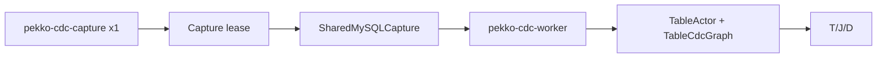
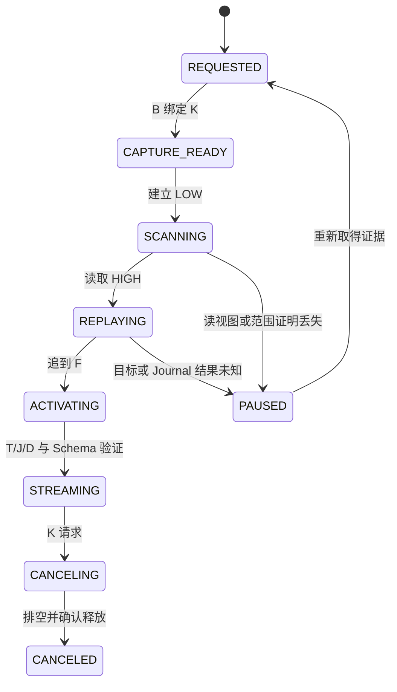
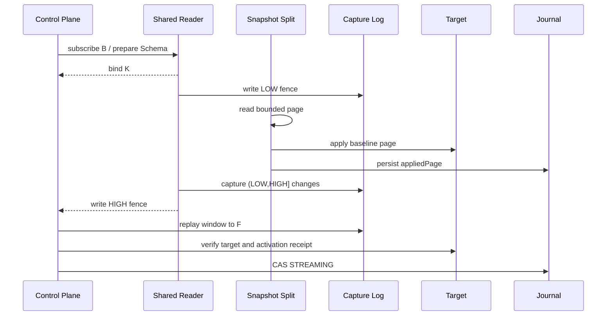

# Pekko CDC 深入解析（四）：LOW/HIGH 水位、窗口回填与全量转流

作者：xuyinyin
[系列导读](README.md) · [Pekko CDC 深入解析（一）](01-why-pekko-for-resident-cdc.md) · [Pekko CDC 深入解析（二）](02-source-and-recovery-contract.md) · [Pekko CDC 深入解析（三）](03-real-mysql-journal-failure.md) · [Pekko CDC 深入解析（四）](04-batch-to-stream-low-high.md) · [Pekko CDC 深入解析（五）](05-pekko-vs-flink-cdc.md)

> **系列主线**：第一篇先拆资源模型；第二篇追一条事件从 Reader 到 T/J；第三篇建立恢复许可；第四篇回答新表如何从全量进入持续流；第五篇再比较两种运行时。
>
> **源码基线**：`b17b9d1659f923fc256e3b09ad73777ac7acc677`；历史实验按各自材料冻结的版本和切点解释。
>
> **证据口径**：源码结论来自当前 `BootstrapRunner`、`SharedMySQLCapture` 和 Split 调用链；实验结果只对应列出的真实 MySQL、Actor Journal、Sink 和固定切点；历史材料不会被当前提交自动继承。


## 本系列的运行时基线

本文以 `master` 分支的两模块 CDC Runtime 为基线。生产模块只有 `pekko-cdc-capture` 和 `pekko-cdc-worker`。Capture 运行一个副本并持有 SharedMySQLCapture。Worker 至少运行两个副本，通过 TaskLease 创建独立的 TableActor 和 materialized TableCdcGraph，不创建第二个 Capture Reader。`pekko-server` 只表示共享兼容库和历史测试入口。



本文的 LOW/HIGH 历史实验来自各自冻结版本；当前源码阅读基线是 `b17b9d1659f923fc256e3b09ad73777ac7acc677`。除非段落明确写出“本轮重跑”，历史 I01—I24 的结果只说明当时版本和切点，不自动升级为当前提交的端到端结果。

> 本文回答一个经常被简化的问题：一张新表先做全量，再追上实时变更，究竟需要哪些边界？答案不是“读完快照再启动 binlog”，而是把订阅意图、读视图、窗口回填、日志回放和流式发布串成一条可恢复状态机。
>
> 本文以当前 Pekko CDC Runtime 的状态机为主线；实验只用来检验其中明确列出的窗口和切点，历史版本与当前源码不一致时按段落说明。

## 0 结论

批转流至少要维护七个不同的事实：

1. `B`：这张表已经被请求订阅，但是否被 Reader 接纳仍未确定；
2. `LOW`：初始化读视图建立时的源日志位置；
3. `HIGH`：这次初始化窗口允许回填到的上界；
4. `K`：控制 marker 在共享 Reader 中真正完成的边界；
5. `F`：回放追到的、可以把任务切换到持续同步的日志前缀；
6. `T/J/D`：目标提交、Journal 持久化和源端实际 ACK 的三条证据链；
7. `Schema`：目标写入所使用的字段版本。

其中，`B` 和 `K` 解决“是否已经捕获”，`LOW/HIGH` 解决“全量读覆盖哪一段”，`F` 解决“何时可以发布实时流”。把它们压成一个 `ready=true` 会把三种不同的故障窗口混成一个不可恢复的布尔值。



这张图把“捕获就绪”“初始化完成”和“业务可见”拆成三个转移；任何一个转移条件未知，都只能停在 `PAUSED`。

当前实现已经有这个方向的代码骨架：`CdcBootstrapKernel` 负责把任务和 capture 组装起来，`SharedMySQLCapture` 负责共享 Reader 与原始回调前缀，`BootstrapRunner` 驱动快照、回放和尾部增量，`CdcTaskStore` 持久化任务 phase、grant 和 continuation。它能表达这条状态机，但并不意味着所有状态转移都已经在真实环境覆盖。

状态机中的一次正常转移对应下面的时序：



这里的关键不是“快照和 binlog 同时运行”，而是每个边界都能在恢复时重新定位：B/K 约束订阅身份，LOW/HIGH 约束窗口，F 约束发布，T/J/D 约束交接。

先用一张状态图固定阅读顺序：

```text
REQUESTED(B)
    │ Schema 已准备，等待 marker
    ▼
CAPTURE_READY(K)
    │ 建立读视图，记录 LOW，分片读取
    ▼
SCANNING(LOW/HIGH)
    │ 回放窗口内变更，写入独占空目标表
    ▼
REPLAYING(F)
    │ T/J/D 覆盖关系成立，逐字段对账通过
    ▼
STREAMING

任意阶段：证据未知 → PAUSED / UNKNOWN
取消：REQUESTED 或 CAPTURE_READY → STOP / CANCELED
```

## 1 为什么“快照读完再追 binlog”会漏数据

假设全量扫描在时刻 `t0` 打开一致性读视图，读到主键范围 `[1, 100]`。在扫描尚未完成时，另一个事务对主键 10 做了更新，随后对主键 150 做了插入。若 Reader 只在快照结束后从一个新位置启动，主键 10 的修改可能已经被快照覆盖，也可能已经错过回放窗口；如果只用一个分页游标续读，还可能在重启后漏掉排序更靠前的新行。

正确做法是先让 Reader 记录 `LOW`，继续把 LOW 之后的变更写入持久化日志 `L`，再在快照读视图中完成有限范围的全量读取。快照结束时得到 `HIGH`，全量结果先写入独占空目标表，之后再回放 `L[LOW, HIGH]` 之间以及 HIGH 之后已经捕获的变更，直到形成稳定的 `F` 前缀。

这是一种覆盖证明：全量负责读视图建立前已经存在的行，`L` 负责读视图建立后到实时切换前发生的变化。两者的交集由幂等写和版本判断消解，缺一不可。

## 2 状态模型：B、LOW、HIGH、K、F、T/J/D

### 2.1 B 不是捕获完成

用户请求新增表时，控制存储先写入订阅意图。这个意图包含表标识、generation、Schema 版本和请求序列。此时只能得到 `B=requested`，不能声称 Reader 已经开始接收该表的变更。

`SharedMySQLCapture` 要在源库控制表写入 marker，并通过 Debezium 回调看到对应事务结束，才能将意图绑定到真实 capture point。当前 Reader 对控制事务有 `event_count == 1` 的要求；如果 marker 和目录写入混入一个事务，实际事件数可能不再是 1，B 必须停在未知或失败态。

从调用链可以看到，`processTransactionMetadata` 将控制事务解析、意图匹配和 barrier sequence 写入作为一个边界；没有匹配到当前 generation 时不能推进 K。

**实验边界**：marker 与目录表同事务导致的 Debezium 事件计数，尚未在当前最终 Reader 版本完成实测，不能把“单条 SQL”写成“单条行事件”。

### 2.2 LOW 与 HIGH 是窗口两端

- `LOW` 是快照读视图打开后，Reader 已经接纳并开始写 L 的位置。
- `HIGH` 是初始化阶段固定的上界，表示本次全量读不再向后扩展。
- `K` 是控制 marker 已经在共享 Reader 中完成的序列边界。
- `F` 是回放和校验已经追平的日志前缀。

一个安全的转流条件应至少满足：

$$
bind(B, generation, sourceFence) = K, \quad F \geq HIGH, \quad cover(T,J,D)=verified
$$

这里有三种不同关系：B 是订阅意图，K 是 Reader 看到控制 marker 后形成的绑定边界，两者不是可以直接比较大小的数字；F 与 HIGH 只有在同一 capture、同一 generation、同一 source lineage 下才可以比较；`cover(T,J,D)=verified` 表示三条证据对当前发布前缀形成覆盖关系，不要求三个位置数值相等。若 owner、generation 或 Schema 不一致，即使序列号更大，也不能视为覆盖。

| 条件 | 读法 | 不成立时的动作 |
|---|---|---|
| `bind(B, ...) = K` | 订阅意图已经绑定到真实 Reader 边界 | 保留 B，暂停初始化或等待 marker |
| `F ≥ HIGH` | 回放已经覆盖初始化窗口上界 | 继续回放，不能发布 |
| `cover(T,J,D)=verified` | 目标、Journal、ACK 证据属于同一批次和同一代 | 重放或安全暂停 |

### 2.3 T/J/D 不能互相替代

- `T` 表示目标 Sink 对某个批次已经返回提交结果；
- `J` 表示 Journal 已经持久化该批次的身份、ACK 归属和恢复 receipt；
- `D` 表示 Reader 可以证明的实际源 ACK 前缀。

当 `T` 已提交而 `J` 未持久化时，恢复必须重放批次并依靠目标幂等；当 `J` 已持久化而 `D` 仍滞后时，不能把 Journal 记录当成源端已经 ACK。只有三条证据在同一任务 generation 下形成闭环，才允许推进 `F` 或回收 `L`。

## 3 源码调用链：从订阅到 STREAMING

### 3.1 启动与准入

`CdcBootstrapKernel.start()` 先初始化状态库和 capture，再建立 `SharedMySQLCapture`。`CdcPlatformRuntime` 负责 owner lease、任务索引和双池资源准入；`CdcTaskStore.claim` 在事务内把可调度任务改为 `IN_USE` 并写入 grant，避免重启后两个 worker 同时认为自己拥有同一表。

这一步只证明“任务可以运行”。它不代表表已经完成全量，也不代表目标已对外发布。

### 3.2 快照和分片

`BootstrapRunner` 通过 bounded step worker 调用 `BootstrapSnapshot`，按主键范围读取源表。每个 Split 都有自己的范围、批次 revision 和重试边界；批次提交后写入 Journal 和目标账本。执行器不把大表一次性装入内存，也不把所有表的扫描放到 Actor dispatcher 上。

源码层面可以得到以下不变量：

- 未完成 Split 不能被标记为完成；
- 重试使用同一批次身份或可证明的后继身份；
- 取消只能停止未接纳的工作，不能伪造已完成的 F；
- 目标发布前使用独占空目标表，避免业务读到尚未回放的快照。

### 3.3 回放到 F

快照完成后，`BootstrapReplaySink` 从 L 中读取 LOW 之后的记录，按照表 generation、事务和事件身份分组。每个组先验证 Schema 与目标幂等键，再写 Sink、Journal 和 ACK 证明。`BootstrapRunner` 只有在回放前缀和目标校验都完成后，才把任务 phase 改为 `STREAMING`。

这个转换是单向的：`STREAMING` 不是“Reader 有数据”，而是“该表的全量和窗口变更已经被目标吸收，并且从 F 开始可以继续消费实时增量”。

### 3.4 `BootstrapRunner.scanStep` 的实际算法

源码中的 `scanStep` 不是一个大事务，而是一个可重复调用的推进函数。把 `BootstrapRunner.scala:174-229` 展开，可以得到以下伪代码：

```text
if no current window and nextLower == frozenUpper:
    write F fence; phase = REPLAYING; deltaAfter = B.sequence
else if no current window:
    u = source.nextUpper(nextLower, frozenUpper, chunkRows)
    persist WINDOW_REGISTERED(index, lower, u, schema)

if window has no sealed manifest:
    LOW = fence(window + "_L")
    source.scan(lower, upper, pageRows) -> RAW pages
    HIGH = fence(window + "_H")
    fold RAW rows and L groups in (LOW, HIGH]
    seal(manifest, rawPageHashes, groupRoot, finalRows)

verifyWindow(manifest)
for page from appliedPage until pageCount:
    target.applyPage(window, page, manifest, finalRows)
    persist appliedPage = page + 1
complete(window, completionRoot)
advance nextLower = upper
```

这里有四个容易被忽略的顺序约束：

1. `LOW` 在 `source.scan` 之前写入，且只对当前 window 生效；
2. `HIGH` 在源扫描关闭后写入，`fold` 只消费 LOW 之后、HIGH 之前的 L；
3. `seal` 先把原始页 hash、窗口 spec 和 group root 固化，`applyPage` 只接收已 seal 的 manifest；
4. `appliedPage` 每成功一页才推进，重启从最后一个已确认 page 继续验证，而不是重读一个未证明的整表结果。

窗口不变量可以写成：若 `W=(LOW,HIGH,RAW,DELTA)` 已 seal，则

$$
Rows(W)=Snapshot(LOW,HIGH)\;\oplus\;Replay(L[LOW,HIGH])
$$

其中 `⊕` 不是简单拼接，而是按主键折叠 INSERT/UPDATE/DELETE；`verifyWindow` 同时检查窗口 spec、LOW/HIGH fence、每个 RAW page hash，以及 L groupRoot。只要其中一个 hash 或 sequence 变化，窗口就不能进入 `applyPage`。

`complete` 还要求相邻窗口的 `lower` 等于前一窗口的 `upper`，并把本窗口 digest 纳入 completion root。因此，多 Chunk 的正确性来自“范围无缝 + 每窗可验证”，不是来自最后一次全量 count。

### 3.5 多 Chunk 正确性的归纳不变量

把第 `i` 个窗口的范围记为 `W_i=(L_i,U_i]`，把窗口封存后的行状态记为 `S_i`。`scanStep` 的范围推进不是靠一个全局游标，而是维护下面两个关系：

$$
L_0=\varnothing,\qquad L_i=U_{i-1},\qquad U_i=nextUpper(L_i,U,chunkRows)
$$

因此相邻窗口没有空洞，也没有重叠。窗口内部则按下面的递推计算：

$$
S_i=Fold\bigl(Snapshot(W_i),\;L[LOW_i,HIGH_i]\bigr)
$$

`BootstrapFold` 对同一主键使用 replace 语义：DELETE 移除键，CREATE/UPDATE 用完整 after image 覆盖键。它不把每一条 binlog 事件直接写成目标最终态，而是先得到窗口的 canonical rows，再由 manifest 的 page hash 和 groupRoot 保护输出。

这解释了三个故障处理动作。窗口尚未 seal 时丢失读视图，旧 `window` 被 abandon，`attempt` 加一，`appliedPage` 清零并重新夹住 LOW/HIGH；窗口已经 seal 后，重启只从 `appliedPage` 继续验证和应用；窗口完成后，`nextLower` 才推进到 `U_i`。如果把这三种状态混成一个 cursor，就无法判断“可以重放当前页”还是“必须重新获得同一读视图”。

已有 I08、I11、I16 材料验证了范围边界、双向主键迁移和 T 已提交/J 未推进时的页面重放。它们证明的是固定窗口中的递推关系和目标幂等，不是任意隔离级别、任意排序键或任意多主键表都满足该归纳。


## 4 三个关键故障窗口

### 窗口一：初始化中取消

如果任务只有 B 还没有 K，取消可以删除待接纳意图，但不能推进 D，也不能删除其他表共享的 L。若已经拿到 K，取消需要写 STOP marker，等待当前回调前缀处理完，再关闭该表的 assembler、Journal session 和目标临时表。

从调用链可以看到，取消路径区分 pending 与 capture-ready；共享 Reader 的 ACK 前缀不能被一个表的取消越过。

这里仍有一个边界：所有取消时刻叠加 Schema 变更、目标写入超时和 source disconnect 的组合窗口，还没有完整矩阵。

### 窗口二：T/J/D 不同速

最危险的顺序不是“代码抛异常”，而是三个事实分别落在不同组件：Sink 已提交、Journal 没写完；Journal 已写完、Reader ACK 还没推进；Reader ACK 已推进、Sink 返回结果未知。每种顺序都要求不同的恢复入口。

当前实现对结果不确定的提交保守置为 UNKNOWN/PAUSED；明确拒绝不会消耗自动恢复预算。这个策略保护了正确性，但意味着未知 B 或未知提交结果不会被强行推进到 STREAMING。

### 窗口三：跨重启的分页游标

真实 MySQL 反例显示，在 `REPEATABLE READ` 快照中读到游标 `b` 后，另一连接可以提交排序更靠前的 `a`；新连接从 `b` 续扫时可能漏掉 `a`。所以“游标已持久化”不等于“扫描范围已证明稳定”。跨重启必须重新建立读视图、重新确认范围或使用额外的源侧版本证明。

这条边界直接影响 LOW/HIGH 的定义：LOW/HIGH 证明的是捕获窗口，不是单独的分页游标正确性。

## 5 把状态机放进真实实验

| 故障窗口 | 固定边界 | 实际结果 | 说明 |
|---|---|---|---|
| I08 | LOW/HIGH 窗口、边界键变化 | 范围重建后逐字段收敛 | 证明固定窗口可以重读，不证明任意游标续扫安全 |
| I11 | 双向主键迁移 | 旧/新键组装后目标结果一致 | 证明当前单主键组装路径，不扩展到复合主键 |
| I16 | T 已提交、J 停在第 0 页 | 页重放返回 `AlreadyCommitted`，最终 64 行、384 字段一致 | 证明目标 ledger 能承接指定重放窗口 |
| 跨重启游标反例 | RR 视图中先读 `b`，后提交更小键 `a` | 新连接从 `b` 续扫可能漏掉 `a` | 持久化游标不能单独证明范围稳定 |


### 5.1 已完成的真实闭环

在真实 MySQL、Actor Journal 和 MySQL Sink 环境中，已有以下闭环证据：

- 多 Split 分页读取，故障后按固定范围重读；
- LOW/HIGH 窗口内的变更回填；
- 回放追到 F 后进入持续同步；
- T/J/D、原始 ACK 顺序和目标逐字段对账；
- ACK proof 分页、实际 D 指针和安全 GC。

最新集群材料中，Source 与 Sink 都是 2 行、6 个投影字段，逐字段一致；ACK proof head 为 7742，节点 7731，引用 7740；一次已完成 GC 操作从 42 推进到 44，删除 1 个 GROUP、回收 235 字节。它证明的是指定版本和固定数据量下的闭环，不是大规模容量证明。

### 5.2 失败证据必须保留

以下结果不能被后续通过覆盖：

- 跨重启分页游标的漏行反例；
- marker 与目录写入同事务时的事件计数风险；
- 关闭后连接列表已空、5 秒窗口内仍出现一条未归属事务，随后才消失。

它们说明状态机的“安全暂停”分支是必要的，而不是实现不够自动化的临时妥协。

## 6 什么时候才能宣布“全量转流完成”

建议把发布条件写成一组可审计的谓词，而不是 UI 上的单一百分比：

1. Schema 已准备，目标临时表存在且不可被业务读取；
2. B 已绑定 K，且 source fence、generation 和 capture 一致；
3. 所有 Split 已完成，快照读视图的范围有证据；
4. 回放已追到 HIGH 之后的 F 前缀；
5. 当前发布前缀满足 T/J/D 的恢复条件；
6. 目标逐字段对账通过；
7. 没有 UNKNOWN grant、未排空事务或活跃旧 owner；
8. 只有以上条件同时成立，才切换业务可见性。

任何一项未知都进入 `PAUSED` 或 `UNKNOWN`，由后续恢复流程重新取得证据。宁可延后发布，也不能把尚未完成的全量表伪装成实时表。

## 下一篇：把状态机放回运行时选择

LOW/HIGH、B/K/F 解决的是一张新表如何安全进入持续流；最后还要回答一个运行时问题：这些责任应该由 Pekko 的 Actor 与控制存储承载，还是交给 Flink CDC 的 Source、Checkpoint 和 Sink 运行时。第五篇据此做条件式比较。

## 附录：源码与实验入口

| 责任 | 入口 |
|---|---|
| 共享 Reader、控制 marker、原始 ACK | [`SharedMySQLCapture.scala`](../../../common/src/main/scala/cn/xuyinyin/magic/connectors/mysql/source/capture/SharedMySQLCapture.scala) |
| 启动与任务装配 | [`CdcBootstrapKernel.scala`](../../../common/src/main/scala/cn/xuyinyin/magic/cdc/platform/CdcBootstrapKernel.scala) |
| 任务资源、恢复和状态 | [`CdcPlatformRuntime.scala`](../../../common/src/main/scala/cn/xuyinyin/magic/cdc/platform/CdcPlatformRuntime.scala) |
| Journal 与批次 receipt | [`BootstrapJournal.scala`](../../../common/src/main/scala/cn/xuyinyin/magic/cdc/bootstrap/BootstrapJournal.scala) |
| ACK proof 分页 | [`CaptureAckPaging.scala`](../../../common/src/main/scala/cn/xuyinyin/magic/connectors/mysql/source/capture/CaptureAckPaging.scala) |
| 真实闭环与 GC 材料 | [`cluster-live-20261113`](../../experiments/2026-11-12-runtime-gc/cluster-live-20261113/) |
| 跨重启分页反例 | [`proof-cursor-snapshot`](../../experiments/2026-10-29-proof-cursor-snapshot/) |

最终结论很具体：批转流不是一个 Reader API，而是一条包含 B、LOW/HIGH、K、F、T/J/D 和 Schema 的状态机。当前实现已经把主要边界写进代码和实验，但跨重启分页证明、marker 事务计数和未知 B 自动恢复仍需单独证据，不能用“全量转流已测过”笼统代替。
