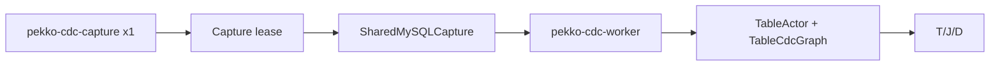
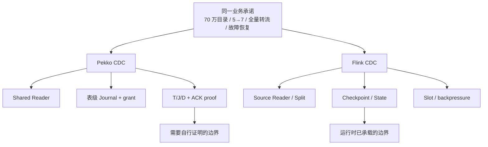
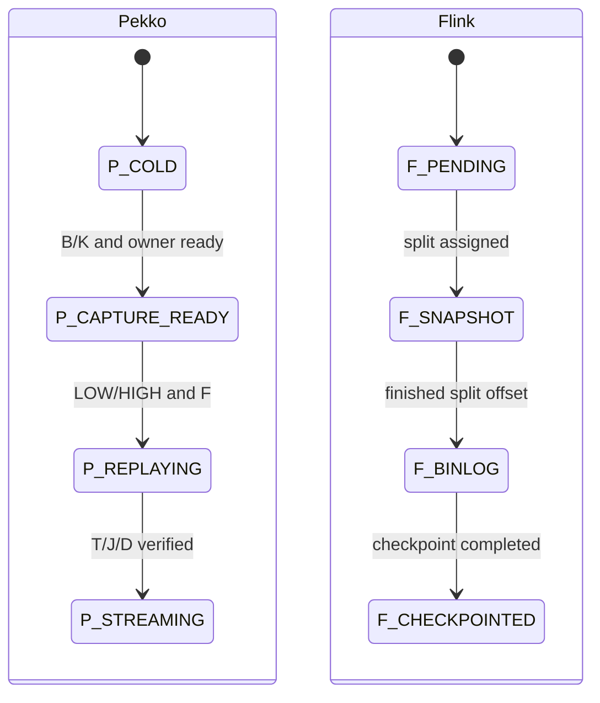
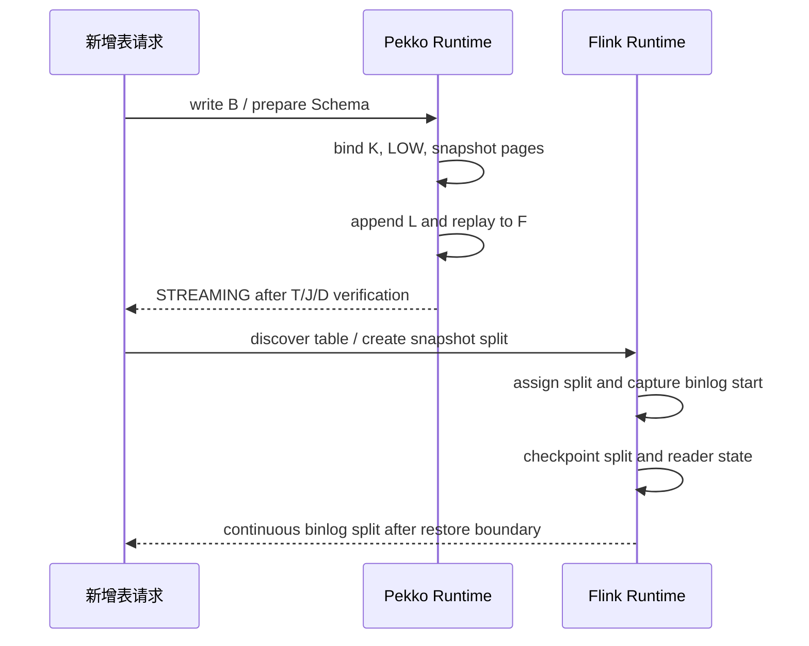

# Pekko CDC 深入解析（五）：Pekko 与 Flink CDC 的运行时边界

作者：xuyinyin
[系列导读](README.md) · [Pekko CDC 深入解析（一）](01-why-pekko-for-resident-cdc.md) · [Pekko CDC 深入解析（二）](02-source-and-recovery-contract.md) · [Pekko CDC 深入解析（三）](03-real-mysql-journal-failure.md) · [Pekko CDC 深入解析（四）](04-batch-to-stream-low-high.md) · [Pekko CDC 深入解析（五）](05-pekko-vs-flink-cdc.md)

> **系列主线**：前四篇先说明资源、事件身份、恢复许可和批转流；第五篇才比较 Pekko 与 Flink CDC 各自承载哪些运行时责任。
>
> **源码基线**：`b17b9d1659f923fc256e3b09ad73777ac7acc677`；历史实验按各自材料冻结的版本和切点解释。
>
> **证据口径**：Pekko 侧引用当前源码和已保存实验；Flink 侧按 Flink CDC 3.6.0 的源码与公开运行模型对照。本轮没有同数据集、同 Sink、同故障切点的 Flink 基准，因此不把架构比较写成性能结论。


## 本系列的运行时基线

本文以 `master` 分支的两模块 CDC Runtime 为基线。生产模块只有 `pekko-cdc-capture` 和 `pekko-cdc-worker`。Capture 运行一个副本并持有 SharedMySQLCapture。Worker 至少运行两个副本，通过 TaskLease 创建独立的 TableActor 和 materialized TableCdcGraph，不创建第二个 Capture Reader。`pekko-server` 只表示共享兼容库和历史测试入口。



Flink 对照按 Flink CDC 3.6.0 的运行模型和源码阅读组织；本轮没有在同一数据集、同一 Sink 和同一故障切点上重跑 Flink。Flink CDC 3.7.0 与 Paimon 实验属于另一组材料，不混入本文的性能或可靠性结论。

> “Pekko 比 Flink 更适合 70 万张表”不是一个可以直接回答的命题。两者首先解决的是不同层次的问题：Flink CDC 提供成熟的流式运行时、Checkpoint 和连接器生态；Pekko CDC 把常驻任务的生命周期、表级状态和有限资源准入放到了 Actor 与持久化控制面中。
>
> 本文不做口号式优劣比较，而是固定同一组语义：新增表先完成全量，再追实时；初始化期间源表继续写入；任务可能重启、取消、提交结果未知；目标端需要逐字段一致。然后分别观察两套模型在哪些边界上有证据，在哪些地方仍然需要补实验。

## 0 结论

在 70 万张表、单个 MySQL 实例、只有少量表活跃的常驻 CDC 场景下，Pekko 的潜在优势是**生命周期粒度和资源准入粒度更细**：目录里的冷表不必对应常驻 Source、连接或线程；新表可以在不停止已有 Reader 的情况下进入自己的初始化状态；取消一张表也不必重启整个 Job。

Flink CDC 的优势是**成熟的流处理语义和运维边界**：Source、Split、Checkpoint、State 和 Sink 已经形成稳定的运行时契约，连接器和生态覆盖更完整。对于活跃表较多、吞吐和状态后端是主要问题的场景，Flink 的现成能力仍然是强项。

因此比较结果是条件式的：

- 如果主要问题是 70 万条目录和少量活跃表的常驻管理，Pekko 的 Actor + Shared Reader + bounded worker 模型更贴近问题；
- 如果主要问题是高吞吐事件处理、复杂算子拓扑、统一 Checkpoint 和大规模状态，Flink CDC 的现成运行时更成熟；
- 如果把 Pekko 的灵活生命周期写成“天然 exactly-once”，或把 Flink 的 Checkpoint 写成“自动解决所有动态表问题”，两种说法都超出了证据。

本文的实测只覆盖当前 Pekko Runtime 的真实 MySQL、Actor Journal 和 MySQL Sink。没有在同一机器、同一数据集上对 Flink CDC 做重新基准测试，Flink 部分是基于公开运行模型和本系列已有源码阅读的设计比较，不是对 Flink 性能的实测结论。



比较的不是组件数量，而是同一业务承诺被哪一层运行时承载。

两套系统在一次“新增表、初始化中发生写入、随后重启”的生命周期中，可以画成两条状态机：



Pekko 把表级发布与 Reader owner、Journal 和 ACK proof 分开保存；Flink 把 split、reader state 和 checkpoint 交给 Source API 和运行时。图中的状态名不能直接互相等价，比较的是恢复责任落在哪一层。

## 1 先比较语义，而不是比较组件数量

下面的时序把同一个故障窗口放到两套运行时中：



这不是性能时序图：它只说明两边把“新增表”和“恢复边界”放进了不同的状态对象。Flink 的持续边界由 split state 和 checkpoint 承载；Pekko 的持续边界由 B/K、窗口 manifest、Journal、目标 ledger 和 ACK proof 共同承载。

一个可比的 CDC 任务至少需要回答六个问题：

1. 新增表时，谁记录订阅意图和 Schema？
2. 全量扫描期间，谁接住源库发生的变更？
3. LOW/HIGH 和窗口回填如何避免漏行？
4. 目标提交、Journal 持久化和源 ACK 如何衔接？
5. 重启或提交结果未知时，谁决定重放、暂停或继续？
6. 取消一张表时，哪些连接、事务、日志和状态可以释放？

如果这些问题没有逐项回答，“支持 CDC”只说明能读到事件，不能说明具备可恢复的全量转流能力。

为了避免把组件名直接当成结论，本文固定四个比较口径：

| 口径 | 要回答的问题 | 证据要求 |
|---|---|---|
| 资源 | 冷目录、活跃表、Reader、连接和 worker 是否分开计量 | 代码路径或同负载运行数据 |
| 进度 | 全量、增量、Checkpoint/Journal 是否能形成可恢复边界 | 源码状态机和重启材料 |
| 故障 | 提交未知、旧 owner、取消和重启如何处理 | 固定切点、原始日志和对账 |
| 规模 | 70 万目录与真实活跃表分别能支撑到哪里 | 分页实验与长期容量实验分开报告 |

## 2 Flink CDC 的强项：把流处理运行时做成基础设施

Flink CDC 的典型模型是：Source 产生 Snapshot Split 和 Binlog Split，Enumerator 分配 Split，Reader 处理快照和增量事件，Checkpoint 保存 Source 状态和下游算子状态，JobManager/TaskManager 负责任务调度和故障恢复。增量快照类算法通常使用低位点、高位点和回填逻辑，把快照读与 binlog 事件接到同一个有界窗口。

这个模型的优点不在某一个 API，而在于运行时已经把几个事实统一起来：

- Split 是可分配、可恢复和可重试的工作单元；
- Checkpoint 是 Source、算子和 Sink 的一致进度边界；
- 算子并行度、背压和状态后端提供统一的资源模型；
- 连接器生态可以复用已有的 schema、序列化和 Sink 语义。

这些能力适合活跃表多、事件吞吐大、需要复杂流处理拓扑的系统。

但动态新增和取消 70 万条表目录仍然有成本：Job 图、Source 配置、Split 元数据和 checkpoint 状态需要有明确的更新策略。本文没有把 Flink 的动态表变更部署、扩缩容和实际连接数重新跑一遍，因此这些方面只保留为比较维度，本文不把它们写成已经测得的结果。

### 2.1 Flink 侧的源码调用链

为了避免把“Flink 有 Checkpoint”写成空泛优点，这里按 Flink CDC 3.6.0 的 MySQL Source 代码追一遍实际责任：

```text
MySqlSourceEnumerator
  -> MySqlHybridSplitAssigner.getNext()
       -> MySqlSnapshotSplitAssigner.getNext()
            -> MySqlChunkSplitter.splitChunks()
       -> createBinlogSplit(finishedSnapshotSplitInfos)
  -> SourceReader.addSplits()
       -> MySqlSnapshotSplitReader / MySqlBinlogSplitReader
  -> checkpoint: enumerator state + reader split state
```

`MySqlSnapshotSplitAssigner` 的 checkpoint state 至少包含 `remainingSplits`、`assignedSplits`、`tableSchemas` 和每个 snapshot split 的 finished offset；恢复构造函数从 `SnapshotPendingSplitsState` 重建这些集合。它不是把整张表一次性读完，而是由 `MySqlChunkSplitter` 按主键范围生成可分配的 split。源码入口可以直接对照：

- [`MySqlSnapshotSplitAssigner`](https://github.com/apache/flink-cdc/blob/release-3.6.0/flink-cdc-connect/flink-cdc-source-connectors/flink-connector-mysql-cdc/src/main/java/org/apache/flink/cdc/connectors/mysql/source/assigners/MySqlSnapshotSplitAssigner.java)
- [`MySqlHybridSplitAssigner`](https://github.com/apache/flink-cdc/blob/release-3.6.0/flink-cdc-connect/flink-cdc-source-connectors/flink-connector-mysql-cdc/src/main/java/org/apache/flink/cdc/connectors/mysql/source/assigners/MySqlHybridSplitAssigner.java)
- [`MySqlSourceEnumerator`](https://github.com/apache/flink-cdc/blob/release-3.6.0/flink-cdc-connect/flink-cdc-source-connectors/flink-connector-mysql-cdc/src/main/java/org/apache/flink/cdc/connectors/mysql/source/enumerator/MySqlSourceEnumerator.java)
- [`MySqlSourceReader`](https://github.com/apache/flink-cdc/blob/release-3.6.0/flink-cdc-connect/flink-cdc-source-connectors/flink-connector-mysql-cdc/src/main/java/org/apache/flink/cdc/connectors/mysql/source/reader/MySqlSourceReader.java)

这条链和本文 Pekko 实现的差异是边界归属：Flink 把 split 分配、reader state 和 checkpoint 交给 Source API；Pekko 把窗口 spec、`appliedPage`、L groupRoot 和 Journal receipt 分开持久化。两者都能表达“可重试的有限范围”，但恢复时要验证的对象不同。

### 2.2 同一个故障窗口里，两套系统各自保存什么

Flink CDC 的 checkpoint 由 Source API 统一保存 split 分配状态、reader split state 和 binlog split 的起点。恢复时，`MySqlSourceEnumerator` 先恢复 `SnapshotPendingSplitsState`，再把未完成 split 分配给 `MySqlSourceReader`；当所有 snapshot split 都完成，hybrid assigner 才把 finished split 的 binlog 起点合并成持续读取边界。这个模型的强项是运行时替 Source 维护了“谁拥有哪个 split、哪个 offset 已进入 checkpoint”。

Pekko 的等价关系分散在三个持久化对象里：窗口 spec/manifest 描述读视图和页，Journal 的 `appliedPage/deltaAfter` 描述任务接受到哪里，L 的 ACK proof 描述 Reader 已经确认到哪里。恢复时没有一个统一 checkpoint 可以替代它们，必须按顺序重建：先验证窗口 identity，再核对目标 ledger，再验证 ACK ancestry，最后才允许 Reader 推进实际 D。

可以把两边的恢复责任写成同一个问题的两种实现：

```text
Flink:  checkpoint(split state) -> restore reader -> continue split/binlog
Pekko:  manifest + Journal + T ledger + ACK proof -> verify relations -> continue L/D
```

差异不在于谁“更可靠”，而在于证明对象不同。Flink 把大量一致性工作收进 Checkpoint/State Backend；Pekko 把 owner、grant、Journal receipt、目标 ledger 和 ACK proof 暴露成可查询的业务协议。前者减少应用层状态机的数量，后者允许把一张表的初始化、取消和恢复从整个 Job 生命周期中拆出来。

这也是公平比较的边界：本系列没有在同一机器、同一数据集、同一 Sink 和同一故障切点上重跑 Flink，因此不能把这段源码差异写成吞吐或 exactly-once 的实测优劣。能比较的是状态归属和故障责任，不能凭架构图推导性能数字。


## 3 Pekko CDC 的强项：把常驻任务的生命周期拆开

当前 Pekko Runtime 的核心分层是：

```text
一个 capture domain
  └── SharedMySQLCapture      一个共享 binlog Reader
        ├── table task A      自己的 Schema / LOW-HIGH / Journal / Sink ledger
        ├── table task B
        └── table task C

CdcPlatformRuntime
  ├── snapshot step budget
  ├── tail step budget
  ├── persistent task index / grant
  └── owner / recovery state
```

这不是“每张表一个永久 Actor”。Actor 主要承担身份、mailbox 串行化和持久化状态；真正的 JDBC 扫描和 Sink 写入在 bounded step worker 上执行。目录中的冷表没有连接、线程和运行时 session，只有任务索引和需要恢复时读取的持久化状态。

### 3.1 Shared Reader 解决什么问题

`SharedMySQLCapture` 把一个 capture domain 的 binlog 会话、原始回调顺序和 ACK 前缀集中起来。新增表时，控制面写入 B marker，Reader 继续接收同一个源连接上的事件，表级 assembler 将事件写入 L。这样，已有表不需要因为新增表而重启 Reader。

这个模型非常适合“今天同步 5 张表，明天再增加 2 张表”的长期运行场景。取消表也可以只关闭对应 assembler、Journal session 和目标任务，其他表仍然使用同一 capture domain。

代价是控制协议更复杂：B、K、LOW/HIGH、F 和 T/J/D 必须一起成立；一个表的未知 ACK 不能越过共享 Reader 的原始回调前缀；共享 Reader 的 source owner 也成为所有表的共同故障边界。

### 3.2 有界调度解决什么问题

`CdcPlatformRuntime` 使用 snapshot/tail 两类预算，`CdcTaskStore.claim` 在事务内持久化 grant。它把“目录里有多少表”和“当前有多少表真正占用连接和 worker”分开。

这让系统可以先验证 70 万条任务元数据的分页和启动成本，再独立验证真实活跃表的连接数、binlog 吞吐和 L 增长。这个拆分是工程上的优势，但不是容量结论：当前证据仍然没有覆盖 70 万张真实物理表长期活跃。

## 4 全量转流的公平比较

两套系统都必须解决同一个因果链：

```text
订阅意图 B
  → Schema 准备
  → 建立 LOW
  → 快照 Split 分页读取
  → 记录 HIGH
  → 回放 LOW/HIGH 窗口内变更
  → 追到 F
  → 目标逐字段校验
  → 对外发布持续流
```

差异在于状态放在哪里：

| 问题 | Flink CDC 的典型承载 | Pekko CDC 当前承载 |
|---|---|---|
| 读取分片 | Snapshot Split / Binlog Split | 表级 Split + `BootstrapRunner` |
| 进度保存 | Checkpoint / operator state | Journal receipt + task state + L |
| 共享源捕获 | Source Reader / Enumerator | `SharedMySQLCapture` + table assembler |
| 资源准入 | 并行度、slot、背压 | snapshot/tail budget + 持久化 grant |
| 失败恢复 | Job restart + Checkpoint | T/J/D 证据、owner lease、保守暂停 |
| 动态新增表 | 依赖作业或 Source 配置策略 | 写入 B，复用 Reader，单表初始化 |
| 取消单表 | 依赖作业拓扑和 connector 能力 | STOP marker + 单表资源释放 |

这个表描述的是模型，不代表两边每个 connector 的实现完全相同。尤其是 Sink 的幂等和 DDL 传播，需要按具体连接器单独验证。

### 4.1 同一业务承诺下的责任矩阵

| 语义问题 | Pekko 当前实现 | Flink CDC 3.6.0 典型承载 | 本文证据等级 |
|---|---|---|---|
| 快照拆分 | `BootstrapRunner` 的主键范围窗口、RAW page | `MySqlChunkSplitter` + snapshot split | 两边源码可读；未做同负载 benchmark |
| 快照期间变更 | LOW/HIGH 之间读取 L 并 fold | snapshot split finished offset + binlog split | Pekko 有真实固定窗口；Flink 未在本轮重跑 |
| 进度持久化 | Journal progress + task state + L ACK proof | enumerator/reader checkpoint state | 两边都可从源码定位 |
| 目标幂等 | MySQL group ledger evidence | 由具体 Sink/两阶段提交实现 | Pekko MySQL Sink 已做固定实验；跨 Sink 未证 |
| 动态新增表 | 写 B marker，复用已有 Reader | 依赖 enumerator 的表发现/作业配置策略 | Pekko 有设计和固定材料；Flink 动态增表未测 |
| 资源边界 | snapshot/tail grant、pending bytes、capture owner | 并行度、slot、背压和 Source reader | 都是运行模型，不是本轮容量实测 |

这个矩阵的目的，是防止把“Flink 有统一 Checkpoint”或“Pekko 有 ACK proof”直接翻译成端到端 exactly-once。真正的比较必须把相同的 source table、同一个事件身份、同一个目标账本和同一故障切点同时放进两边；本轮没有这样的对照实验。

## 5 故障恢复：Pekko 更灵活，也更容易把协议写错

Pekko 当前把恢复事实拆成三条：

- `T`：目标是否已经提交；
- `J`：Journal 是否已经持久化 receipt；
- `D`：Reader 实际确认到哪一个 ACK 前缀。

这样的拆分能明确处理“提交结果未知”“T 已提交但 J 未持久化”“J 已持久化但 D 滞后”等窗口。`CaptureAckPaging` 又把 ACK ancestry 持久化成可分页 proof，并在 `CaptureGcRetention` 中只回收当前 D 之外、没有被 checkpoint、订阅或 B proof anchor 引用的证明。

它的代价是系统必须自己维护很多不变量：source fence、owner 隔离、grant、Journal receipt、目标账本、ACK proof 和 GC 的关系都不能靠一个 Actor 消息顺序代替。当前实现对结果未知选择 `UNKNOWN/PAUSED`，这是正确性边界，也是运维复杂度。

Flink 的优势在于 Checkpoint 将 Source 和算子状态放进统一恢复协议。其代价是恢复边界更多地由 Job、State Backend、Checkpoint Storage 和 connector 共同决定；对于动态增删表的常驻管理，仍然需要额外的配置和作业控制层。

## 6 成本模型：不要把目录规模当成活跃执行规模

可以先把比较拆成四个成本项：

$$
C_{total}=C_{cold}(N)+C_{capture}(R)+C_{active}(A,W)+C_{proof}(L,T,J,D)
$$

其中 `N` 是目录规模，`R` 是共享 Reader 数，`A` 是活动表数，`W` 是执行预算，`L/T/J/D` 的变化率决定证明和保留成本。Pekko 主要试图压低 `C_active` 的冷启动部分；它不能消除 Schema、binlog、日志保留和证明成本。Flink 主要把 `C_active`、状态和故障恢复交给统一运行时，但同样需要为 Source、Split、Checkpoint 和 Sink 保留状态。

## 7 把比较落到实际运行

| 比较对象 | 本轮实际材料 | 可以说什么 | 不能说什么 |
|---|---|---|---|
| Pekko Runtime | 真实 MySQL、Actor Journal、MySQL Sink、KubeSphere | Source/Sink 逐字段一致；owner 重启后恢复；proof 可分页并回收 | 不能外推到 70 万活跃物理表长期容量 |
| Flink CDC | 3.6.0 源码和公开运行模型 | 可以比较 split、reader state、checkpoint 的责任归属 | 没有同数据集、同 Sink、同故障点的本轮实测 |
| 共同业务承诺 | 新增表、全量转流、重启、提交未知 | 可以比较需要维护哪些状态 | 不能凭架构图推出吞吐、延迟或 exactly-once 优势 |


### 7.1 真实端到端证据

当前集群实验使用真实 MySQL、Actor Journal 和 MySQL Sink。Source 与 Sink 的 `source_rows`、`target_source_rows` 各为 2 行，投影字段 `id,label,amount,note,updated_at,revision` 逐字段一致。重启后 owner 为 ACTIVE，任务处于 STREAMING/HEALTHY，ACK proof head 为 7742，节点 7731，引用 7740。

这些证据支持以下结论：在当前版本、固定数据量和固定故障窗口下，Shared Reader、表级任务、Journal、Sink、ACK proof 和安全 GC 能形成一个可恢复闭环。

### 7.2 真实失败也属于结论

已有实验保留了三类失败：

- 跨重启分页游标可能漏掉排序更靠前的行；
- marker 与目录写入同事务时，控制事务的事件计数可能超过 Reader 约束；
- 关闭后连接列表已空，但短窗口内仍有一条未归属事务，随后才消失。

这些失败说明 Pekko 的灵活性并不自动带来更强的语义。它要求系统在无法证明隔离、提交或排空时安全暂停。

### 7.3 回归与未覆盖范围

本地 JDK 17 回归为 722 成功、0 失败、415 个外部环境测试取消。取消项没有被算成通过。ACK proof GC 的集群实验已经验证小批量删除、保护引用和实际 D 更新，但没有证明 70 万真实活跃表的长期容量。

Flink CDC 在本次工作中没有跑同等数据集、同等故障注入和同等逐字段对账，因此不能据此宣称 Pekko 的吞吐、延迟或资源占用优于 Flink。

## 8 选择建议：按主导矛盾选，不按品牌选

### 更适合 Pekko 的情况

- 单个或少量 MySQL 实例，目录规模远大于同时活跃表规模；
- 需要常驻运行，表可以动态新增、取消和重新初始化；
- 业务更关心表级生命周期、连接上限和恢复上下文；
- 团队愿意维护 B/LOW/HIGH/F、T/J/D、owner 和安全暂停协议；
- 目标端可以提供明确的幂等键、账本和逐字段对账。

### 更适合 Flink CDC 的情况

- 活跃表和事件吞吐是主要规模，复杂算子和多级流处理不可避免；
- 团队希望优先复用 Checkpoint、状态后端、背压和连接器生态；
- 动态表变更可以通过作业配置或平台流程治理；
- 需要把数据处理、窗口、Join 和下游流计算放在同一个成熟运行时。

### 两者都不能绕过的工作

- 真实 MySQL 故障窗口；
- Sink 提交结果未知和幂等；
- Schema/DDL 传播；
- 跨重启的快照范围证明；
- 源 owner 隔离和事务排空；
- 70 万目录与真实活跃表的容量分开测量。

## 9 最终判断

Pekko CDC 的合理目标不是复制 Flink 的全部能力，而是用更细的生命周期和资源边界解决“一个数据库、70 万张表、长期常驻、每天动态增删少量表”的问题。当前代码已经具备 Shared Reader、表级 Journal、LOW/HIGH/F 状态、持久化 grant、T/J/D 恢复和安全 GC 的骨架，并有固定版本的真实闭环证据。

但“和 Flink CDC 差不多”只能在语义边界上说：两者都能实现全量转流和故障恢复的某些路径；在运行时成熟度、生态、吞吐和大规模活跃表容量上，当前没有对等实测，不能把 Pekko 的优势扩展成全面替代。

## 系列结语

这五篇文章的主线到这里闭合：先约束资源，再固定事件身份，再建立恢复证据，随后完成批转流，最后比较两种运行时的责任边界。文章中的模型、源码和实验仍应按各自版本与切点阅读；尚未验证的容量、DDL、跨实例和同负载 Flink 基准，不会因为主线闭合而自动成为结论。

## 附录：证据与源码入口

| 内容 | 材料 |
|---|---|
| 共享 Reader 和 owner | [`SharedMySQLCapture.scala`](../../../server/src/main/scala/cn/xuyinyin/magic/connectors/mysql/source/capture/SharedMySQLCapture.scala) |
| 任务、预算和恢复 | [`CdcPlatformRuntime.scala`](../../../server/src/main/scala/cn/xuyinyin/magic/cdc/platform/CdcPlatformRuntime.scala) |
| ACK proof 与保护引用 | [`CaptureAckPaging.scala`](../../../server/src/main/scala/cn/xuyinyin/magic/connectors/mysql/source/capture/CaptureAckPaging.scala) |
| 安全 GC | [`CaptureGcRetention.scala`](../../../server/src/main/scala/cn/xuyinyin/magic/connectors/mysql/source/capture/CaptureGcRetention.scala) |
| 集群闭环与逐字段对账 | [`cluster-live-20261113`](../../experiments/2026-11-12-runtime-gc/cluster-live-20261113/) |
| 真实失败证据 | [`proof-cursor-snapshot`](../../experiments/2026-10-29-proof-cursor-snapshot/) |
| 对照阅读风格 | [MySQL Monthly](http://mysql.taobao.org/monthly/) |

如果下一步要做真正的技术对比，应把同一 MySQL 数据集、同一 Source/Sink 语义、同一故障窗口和同一逐字段对账脚本同时跑在两套系统上。否则，文章最多能说明架构取舍，不能说明谁在生产上“更快”或“更稳”。
