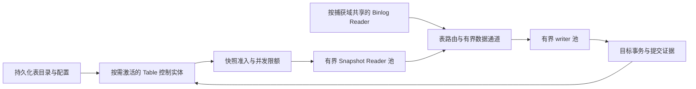

# 一：70 万张表，为什么考虑用 Pekko 做 CDC

我阅读 Flink CDC 的源码和论文，是想把可靠的数据同步能力引入自己的 Pekko 项目。推动这个想法的业务背景很具体：上一家公司有 70 多万张表，需要长期保持同步任务。这样的系统既要处理数据变化，也要长期管理大量表的状态、配置、暂停、恢复和异常。

Actor 很适合表达后一类问题。但从“一个 Actor 可以代表一张表”到“一个系统可以可靠同步 70 万张表”，还隔着日志读取、连接预算、批次恢复、Schema 演进和故障隔离。本篇先把这个距离讲清楚。**70 多万表来自需求背景；下文的资源模型是推理，尚无这个规模的运行结果。**

[系列目录与版本口径](README.md)固定了源码基线和证据标签。

## 1. 表一直存在，不等于所有资源一直占用

“常驻任务”至少有三种含义。第一，任务定义和进度一直存在，重启后仍能找到。第二，数据库一有变更，系统就能持续接收。第三，每张表始终拥有自己的线程、连接和读取器。

前两种是业务要求；第三种只是实现选择。如果把三者绑在一起，70 万张表就会被放大成 70 万套数据任务。即使外面包的是 Actor，里面独占的线程、JDBC 连接、Debezium 队列和 Schema 缓存也不会消失。

我希望保留的是表的**逻辑身份与可恢复生命周期**，把昂贵资源交给有界的数据执行单元。例如，冷表保留持久状态，日志读取器继续捕获整个捕获域的变化；只有收到相关变更、启动快照或处理控制请求时，才激活相应处理资源。这里的捕获域指可以共享同一条源日志读取与恢复进度的一组表，常见边界是一个 MySQL 实例，但还受权限和隔离要求约束。

Pekko 的 Dispatcher 可以让多个 Actor 共享执行线程；Cluster Sharding 用逻辑 ID 路由实体，Passivation 可以释放不活跃实体。这些机制提供了实现上述分离的工具，不能直接换算成具体容量。[Dispatcher 文档](https://pekko.apache.org/docs/pekko/1.1/typed/dispatchers.html)、[Sharding 与 Passivation 文档](https://pekko.apache.org/docs/pekko/1.1/typed/cluster-sharding.html#passivation)说明的是机制，本项目没有测得单个 Actor 的固定内存成本。

对于运行着长期 Stream 的 Actor，还不能按“长时间没有控制消息”直接判定它空闲。当前 Actor 的 PostStop 会取消 Engine；草率钝化会把数据采集一起停掉。因此，控制状态与持续读取的生命周期分离，是需要设计和验证的变更。

## 2. 先数清五种不同的数量

我会用下面五个量描述业务，避免只拿表数做容量判断：

| 量 | 含义 | 主要成本 |
|---|---|---|
| N | 注册表总数 | 元数据、逻辑身份、Schema、配置索引 |
| C | 捕获域数量 | 日志连接、解码、offset、源端负载 |
| A | 同时活跃的表数 | 数据缓冲、路由、写入和热点竞争 |
| S | 同时运行的快照分片数 | JDBC 连接、扫描带宽、快照与日志衔接状态 |
| W | 同时工作的目标 writer 数 | 目标连接、事务、批量缓冲、提交压力 |

N=70 万不能推导出 C=70 万，也不能推导出 A=70 万。少量实例里的大量冷表，与大量实例里的高频热表，是两种不同的工程问题。还要补充总变更字节率、事务大小、每表 Schema 大小和允许延迟，才能判断哪个资源先耗尽。

一个用于设计的成本表达式是：

```text
运行内存 ≈ 活跃控制状态 + 捕获域解码缓存 + 快照缓存 + writer 缓冲 + 运行时开销
持久状态 ≈ 全表元数据 + Journal + offset/history + 去重账本
```

这些项不能都按活跃表数缩减。例如全量 Schema 索引可能仍与 N 成正比；共享日志读取器的解码成本也可能受同实例中其他业务日志影响。Actor 的轻量性只有与资源复用、限额和清理机制结合，才可能变成总成本优势。

## 3. 当前项目已经有什么

**源码事实。** [`WorkflowSharding`](https://github.com/Xuxiaotuan/pekko-reference/blob/d88ec80f2a7166cfdaddf1284cc268a68bc62e28/pekko-server/src/main/scala/cn/xuyinyin/magic/workflow/sharding/WorkflowSharding.scala#L38)以 workflowId 创建实体，并路由到 worker 节点。它分配的是完整工作流，不是把一个工作流里的算子自动分散到多个节点。默认 100 个 shard 也不等于 100 个 CDC 快照读取器。

[`EventSourcedWorkflowActor`](https://github.com/Xuxiaotuan/pekko-reference/blob/d88ec80f2a7166cfdaddf1284cc268a68bc62e28/pekko-server/src/main/scala/cn/xuyinyin/magic/workflow/actors/EventSourcedWorkflowActor.scala#L164)保存定义、执行身份和进度。Journal 恢复后，它可以重新启动中断的执行。这给海量任务管理提供了可用的骨架：任务不是一个只能靠内存记住的 Future。

数据执行则由 [`WorkflowExecutionEngine`](https://github.com/Xuxiaotuan/pekko-reference/blob/d88ec80f2a7166cfdaddf1284cc268a68bc62e28/pekko-server/src/main/scala/cn/xuyinyin/magic/workflow/engine/WorkflowExecutionEngine.scala#L169)启动本地 Pekko Stream。当前 CDC 路径限定为 MySQL CDC Source 直连 MySQL CDC Apply Sink，没有分布式算子状态快照，也没有任意有状态计算的恢复协议。

因此，现有项目适合继续发展成持久化任务控制平台，但不能把工作流分片等同于已经具备 Flink 的分布式数据执行能力。

## 4. 当前最重的对象仍是一张表一个 Engine

**源码事实。** [`MySQLCdcSourceNode`](https://github.com/Xuxiaotuan/pekko-reference/blob/d88ec80f2a7166cfdaddf1284cc268a68bc62e28/pekko-server/src/main/scala/cn/xuyinyin/magic/workflow/nodes/sources/MySQLCdcSourceNode.scala#L129)在创建资源时启动 Debezium Engine。配置只包含当前 database/table，offset 与 Schema history 按 connectorId 使用隔离表。

如果为 70 万张表各建一个这种工作流，系统增长的就不只是 Actor 数量，还包括 Engine、读取连接、状态表和后台资源。当前源码没有实现“一个实例共享一个读取器，再路由到多张表”的模式。这是现状与目标之间最直接的差距。

下一阶段的**设计提案**是把两层拆开：



图中 Table 控制实体、共享读取和池化执行都属于目标设计，不是现有类名或已实现拓扑。控制实体负责阶段、Schema 版本、所有权和恢复决策；大批量数据尽量走有界流通道，避免每条记录都经过跨节点 Actor 请求应答。

共享读取也带来新的耦合：如果同一日志流中一张表写入很慢，源进度能否越过它？如果不能，它会阻塞同域其他表；如果能，就必须先把它的待处理记录可靠地保存到可重放介质。只做内存路由就提前确认源进度，会把进程崩溃变成不可恢复缺口。资源共享必须与第四篇的进度模型一起设计。

## 5. Actor 并不自动提供数据背压

Pekko 的默认邮箱是无界的；换成有界邮箱，溢出消息也可能进入 dead letters。有限容量本身不等于生产者得到可重试的背压信号。[Mailbox 官方说明](https://pekko.apache.org/docs/pekko/1.1/typed/mailboxes.html#introduction)

因此，控制命令需要明确的接收、拒绝和重试契约；数据通道需要队列容量、流量预算和确认协议。慢表隔离还需要回答缓存满后暂停谁、数据保存在哪里、何时允许推进共享 offset。这些机制需要应用实现。

项目现有的 Debezium 批次桥接已经采用有界队列与确认等待，可以保留这条局部背压链。但一条单表 Stream 的有界性，不能证明共享捕获域和多个 writer 之间也有界。

## 6. 学习 Flink CDC，是为了把正确性约束带过来

我希望借鉴的是它对快照分片、日志位置、Schema 传播和恢复状态的处理方法，而不是仅复制 Source/Sink 的接口形状。比如，给扫描任务记录一个最大主键，不能自动得到增量快照的 LOW/HIGH 回填协议；把最近批次写进 Actor Journal，也不能自动得到整个计算图的一致切面。

这也是接下来几篇的顺序：先沿当前代码说明三个进度如何形成，再用真实故障确定隐含假设，最后讨论怎样改造。Pekko 在大量独立任务的生命周期管理上提供了合适的表达方式；它是否适合这个 70 万表业务，还取决于是否能共享昂贵资源，以及团队能否承担 CDC 协议的实现与维护。

下一篇：[沿源码理解 T/J/D，三个进度为什么不能自动一致](02-source-and-recovery-contract.md)。
