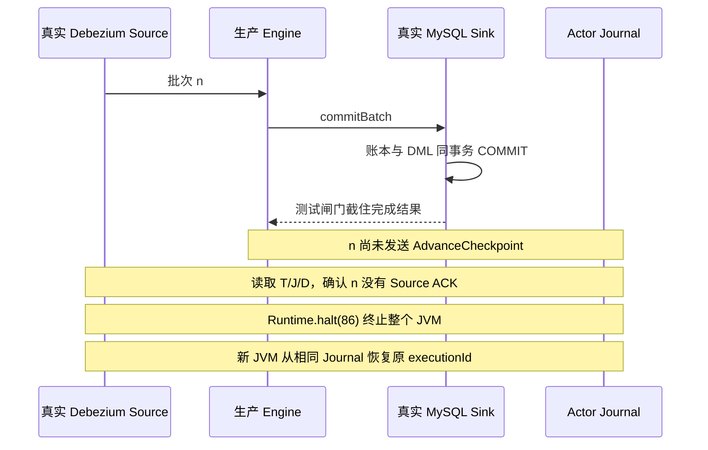

# 三：真实 MySQL 故障实验，批次重放为什么会走向两个结果

第二篇指出：目标已经提交、Actor 还没有持久化 Checkpoint 时，恢复能否成功，取决于重放能否匹配目标账本。只用 mock 返回一次成功、再返回一次失败，无法回答真实 Debezium 重启后会交出什么批次。

我们为此运行了真实 MySQL Source、真实 MySQL Sink 和 JDBC Actor Journal，在两个独立 JVM 之间恢复。**结果是：1 条完整重放成功；16 条改为每批 1 条后，相同 batchId 触发账本冲突，Actor 进入失败状态，后续数据未能追平。** 本篇整理的是 2026-10-18 已执行实验及原始证据；写作阶段核对材料，没有重新运行实验或修改恢复协议。

[系列目录](README.md)给出版本口径；[原始报告](../experiments/2026-10-18-cdc-journal-window.md)给出测试入口和复跑命令。

## 1. 先定义我们究竟要证明什么

实验问题被限定为：T 中已经有本批的持久提交，J 中还没有，D 保持在该批之前的恢复状态。此时终止进程，再让原工作流从真实 Journal 恢复，观察目标是否重复执行、Actor 是否推进、数据能否追平。

“数据库最终行数相同”不是充分验收条件。我们同时记录原始批次、恢复批次、三份进度、目标 DML 审计，以及源目标全表逐字段差异。这样可以区分三种现象：重放被正确去重；重放被拒绝导致停机；系统继续运行却把错误数据当成成功。

实验使用 MySQL 8.4.11，ROW/FULL binlog、GTID ON；Pekko 1.1.3，Debezium 3.6.1.Final，Microsoft OpenJDK 17.0.14。正式窗口实验的子 JVM 固定 UTC。每组独立数据库，源表 64 行、6 列：`id,label,amount,note,updated_at,revision`，包含 Unicode、NULL、空串、DECIMAL(18,4) 和 DATETIME(6)。

Source、Sink 和 Journal 位于同一个隔离 MySQL 实例，但使用各自的表与连接、独立事务。它不是跨机部署测试。Actor 快照阈值设为 100000，本轮没有触发 Snapshot Store，验证的是 Journal 重放。

## 2. 用提交后的闸门固定窗口

测试子类先调用生产 Sink 的 `super.commitBatch`。这个 Future 成功后，生产 Sink 已经完成目标事务提交。测试再输出 `CUTPOINT`，向上返回一个永不完成的 Promise。

这会让生产 Engine 停在 `commitBatch` 的完成边界，尚不能调用 `checkpointCommitted`。它没有替换 Actor 的持久化回调，也没有伪造恢复 Checkpoint。测试代码分别位于[子进程设施](../../pekko-server/src/test/scala/cn/xuyinyin/magic/workflow/integration/RealMySQLCdcJournalWindowProcess.scala)和[实验编排](../../pekko-server/src/test/scala/cn/xuyinyin/magic/workflow/integration/RealMySQLCdcJournalWindowSpec.scala)。



闸门生效前，先等待初始快照和一条 streaming 标记变更完成，做基线全表对账，并确认 T/J/D 与 ACK 已对齐。闸门生效后再断言 T 比 J 多一批，批次包含本轮 revision=1 变更，且没有该批的 `ACK_BEGIN`。

随后执行 `Runtime.halt(86)`，避免优雅关闭帮忙推进 offset。崩溃后再次读取 D，确认与切点完全相同。恢复进程使用同一 workflowId、persistenceId 和 executionId；从实际 Journal 恢复的 Checkpoint 与故障前记录逐项比较。

T 来自真实账本 SQL，J 同时来自 Actor 查询和反序列化后的 Journal payload，D 来自真实 JDBC offset 表。不同 PID 与 Journal writer UUID 则证明这是新进程接续，不是原内存状态继续运行。

## 3. 成功对照：同一条事件仍组成同一批

成功组的证据目录是 `verified/exact-replay-256621e3d9a6`。原进程 PID=88833，恢复进程 PID=89042；executionId 保持不变。

原批次只有一条 UPDATE。故障切点为 T/J=6/5。恢复时把 Debezium `max.batch.size` 设为 1，实际收到的仍是同一条完整事件，同一 cursor 和同一 batchId：

```text
50e99579f48e916e6a2a19bf8da8e2ea92e8d544c5e48c6b0707e4f8b762582d
```

Sink 查到账本元数据相同，返回 `AlreadyCommitted`。Actor 随后把 J 补到 6，再确认 Source。这是现有代码已经具备的行为。

我们在目标表安装事务内的 AFTER INSERT/UPDATE/DELETE 审计触发器。审计条数为：

```text
基线 65 → 原批提交后 66 → 重放后 66 → 后续三个变更后 69
```

“重放后仍为 66”说明这次重复批没有再次执行目标业务 DML。之后分别更新 id=1、删除 id=64、插入 id=65，流水线继续推进。最终 T/J=9/9，源与目标都是 64 行，全部 6 列逐字段一致，D 与最后确认的 sourceOffset 一致。

这个结果支持的是固定窗口中**同批重放的去重与追平**。它没有覆盖任意批次合并、Schema 变化、跨节点接管或源事务整体原子可见。

## 4. 失败对照：16 条事件恢复成单条回调

失败组的证据目录是 `verified/split-replay-e0fec7eecef7`。原进程 PID=89353，恢复进程 PID=89418。

原阶段允许 `max.batch.size=16`，对 64 行执行一个 UPDATE。闸门要求实际批次至少含两条业务记录；本次捕获到 16 条。故障切点为 T/J=5/4。暂停期间再更新 id=1、删除 id=64、插入 id=65，形成确定的待追平数据。

恢复进程通过测试 Engine factory 把真实 Debezium `max.batch.size` 改成 1。测试没有手工拆分 SourceRecord，没有伪造 offset。实际恢复首批确实只有一条，且完整规范化事件等于旧 16 条批次中的第一条。

两批共享相同 batchId：

```text
837cc2dd6a2f0627a151956ca59ba2c2be635574ffed6dacd1d7110213b65c24
```

但账本需要比较的内容不同：

| 字段 | T 中已提交的批次 | 恢复首批 |
|---|---:|---:|
| batchSequence | 5 | 5 |
| sourceRows / targetRows | 16 / 16 | 1 / 1 |
| cursor.offset.file | mysql-bin.000003 | mysql-bin.000003 |
| cursor.offset.pos | 1390884 | 1390884 |
| cursor.offset.event | 2 | 2 |
| cursor.offset.row | 16 | 1 |

完整 map 包括更多字段，保存在证据 JSON 中。这里只截取能说明分歧的字段，不能据此忽略 GTID 或其他恢复上下文。

Sink 返回 `conflicting MySQL CDC ledger identity`。Actor 随后持久化 `ExecutionFailed`；最终状态是 failed，T/J 停在 5/4。目标审计保持 81→81，没有观察到失败重放新增业务 DML。D 在切点、进程终止后与失败终态保持相同完整值。

这是一个明确的**可用性与追平失败**：系统拒绝了冲突，但没有自动协调两种批次划分。它不是 Reader 静默丢弃行的证据，也不是数据永久不可恢复的证明。本轮没有手工改账本让它继续。

## 5. 同为 64 行，仍然不是同一份数据

失败组最后源、目标都为 64 行，但全量比较发现：目标缺少 id=65，多出 id=64；共同主键中有 48 行存在差异，合计 216 处字段差异。

| 字段 | 差异数量 |
|---|---:|
| amount | 48 |
| label | 48 |
| note | 25 |
| revision | 48 |
| updated_at | 47 |
| 合计 | 216 |

这些差异不能归因成“重放污染了 216 个字段”。故障切点只提交了原 UPDATE 的首批 16 行，其余记录尚未应用，暂停时还有三个新变更。恢复停止使这些待处理差异保留下来。

比较器通过独立 JDBC 连接，在 REPEATABLE READ 事务中完整读取两张表；不复用 CDC 的解码与转换逻辑。源停止写入后进行最终核对，按主键匹配所有行，再比较全部六列。DECIMAL 保留十进制文本和 scale，NULL 与空串分别记录，保留字符串空格和 DATETIME 微秒。

这种方法可以减少“同步和比较共用同一个错误转换函数”的风险，但它仍只覆盖这六种列定义、同一个 MySQL 实例和本次数据集。不能推广成所有 MySQL 类型或跨数据库表示都已验证。

## 6. 前置失败也属于证据

第一次使用默认 JVM 时区运行时，基线就失败了：64 行 DATETIME 从源 `2026-10-18 01:02:03.654321` 写成目标 `2026-10-17 17:02:03.654321`，相差 8 小时。它发生在故障注入之前，不能算进恢复协议的故障结果。

正式窗口实验将子 JVM 固定为 UTC，以隔离这个变量；生产时间转换代码没有修复。文章不能只展示最后的成功日志，然后写“六列在默认部署下已正确同步”。原始失败、全量数据及 SQL 导出都保留在证据包。

另一次 UTC 拆批用例因为初始快照超过 60 秒等待期限而未进入故障窗口。之后只把初始等待上限增至 180 秒，并增加 ARM 前的 T/J/D/ACK 屏障，没有放宽逐字段一致性要求。

最终测试日志为 `2 succeeded, 0 failed`。其中一个测试断言的是失败复现成立。因此这句话表示实验结果符合预期，不能翻译成“恢复协议已经正确”或“项目全部测试通过”。

## 7. 这次实验如何影响下一步

实验证明，当前协议把回调分组当作稳定恢复单位的假设，在允许调整真实批大小的场景下不成立。还没有证明保持相同配置时自然拆批的频率，也没有覆盖 J 已推进而 D 滞后的窗口。

下一步应该讨论身份与提交证据，保留当前事务账本、Journal 和全量对账设施。仅仅增加重试次数，仍会遇到同一账本冲突；绕过冲突，又会失去已经存在的保护。

[完整报告](../experiments/2026-10-18-cdc-journal-window.md)、[证据包](../experiments/evidence/2026-10-18-cdc-journal-window.tar.gz)和 [SHA256](../experiments/evidence/2026-10-18-cdc-journal-window.tar.gz.sha256)可用于独立核对。未验证项包括初始快照恢复、Snapshot Store、Sharding 接管、网络分区、COMMIT 回复丢失、DDL、Paimon、主库切换及日志清理。

上一篇：[沿源码理解 T/J/D](02-source-and-recovery-contract.md)；下一篇：[把实验变成协议约束](04-protocol-and-validation.md)。
