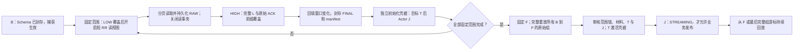

# 第二阶段实现边界：从独占空目标表初始化到持续回放

本轮新增 `workflow/bootstrap` 执行路径，复用已有共享 Reader、原始回调前缀确认、L 和完整组目标账本。旧静态 Split 执行器、旧 Checkpoint/Event 类型及旧 API 的含义不变。这里说明代码行为；真实实验结论以同目录 README 和证据为准。

## 恢复依据

- **B** 表示捕获就绪，不能解释为全量完成。源控制表上的 LOW/HIGH/F 与 B/K 使用不同的意图和记录类型；marker 已出现仍不足以表示窗口完整。新 fence 的可用条件包含原始回调前缀的持久化 ACK 证据链。
- **未封存窗口** 重启时沿用同一 `(lower, upper]`，新建 attempt、LOW 和读视图，整段重读。RAW 页只为当前读视图服务，不能换连接后接着旧页游标读取。
- **已封存窗口** 校验原始页、Schema、LOW/HIGH、窗口内 L 摘要和封存输出。T 已提交而 J 未推进时，只重放保存的 FINAL 字节；目标页凭据必须完全相同。
- **完成范围链** 存在独立索引中，J 只保存当前窗口、已完成序号和根摘要。激活前逐页审核覆盖范围和目标凭据，不把所有已完成 Split 放进 Actor 状态。
- **F** 必须在所有 baseline T/J 完成之后取得。随后重放整个 `(B,F]`，不能按各窗口 HIGH 丢弃事件。初始化目标可能短暂回退到较旧值，因此必须独占且未向业务发布。
- **STREAMING** 同时要求激活审核通过、目标激活凭据存在、J 接受状态转换。空表可以从 F 起步，不伪造一个 GROUP 游标。重启时还要审核历史凭据与已接受游标。
- **ACK 证据层次**：L 中的 ACK frame 证明原始回调前缀已经具备持久化覆盖、允许确认，不代表 SDK 调用已经返回。RAW_ACK_BEGIN、SDK 标记返回、RAW_ACK_RETURNED 和实际 D 分别保留。F 可以已获得完整 L 覆盖而 SDK 的 D 写入仍被阻塞。
- **T/J/D** 职责保持分离：T 证明目标效果及其幂等身份；J 决定执行进度；L 和原始 ACK 覆盖源端读取；实际 D 可以滞后。baseline 使用独立凭据，不冒充源原始组已应用。

## 取消与结果不确定

初始化取消先持久化 CANCELING，不再承接下一窗口或下一页；已承接操作必须结束并确认释放，再确认 K。部分目标保留且未发布。已经存在激活凭据时，会排空捕获区间至 K；取消不会自动删除目标内容。再次增加该表必须用新 generation 和新的独占空目标。

晚于 K 才提交的旧 LOW/HIGH/F 意图保存为 obsolete；它不能作为可用窗口屏障，也不能复活取消的任务或使其他表的 Reader 失败。

可恢复的执行中提交结果不确定最多自动恢复 3 次，同一 execution 的预算不随窗口重置。明确拒绝、证据冲突、容量不足和释放未确认保留上下文暂停。Sink Future 等待超时不会取消其 JDBC 操作，因此进入释放未知，保留 writer/run 额度；连接 close 报错也不能被底层 Sink 的完成结果掩盖。

元数据准备、首次认领等准备阶段错误安全暂停；本轮没有宣称所有准备阶段错误都自动重试。

## 准入与兼容

默认最多 2 个读取窗口、2 个目标写入、8 个显式执行会话。等待和连接需要受超时约束；未知释放保留本进程的额度。读取许可在 RR 连接确认关闭后释放，写入许可在单次 T 操作确认释放后释放；同表会话继续串行推进 J 和窗口状态。释放连接许可不能解释为窗口完成或可换 owner。持续 tail 会占用本版的 run 会话额度，因此这里还不是 70 万活跃 Actor 的调度器。首次材料登记短暂串行，避免空注册表中的 InnoDB 间隙锁升级死锁。缺失 registry 不能用 `used_bytes=0` 重建；恢复时即使子材料一起丢失也拒绝把它当首次创建。

旧类型的 FQN 和字段含义不变，新增 `BootstrapProgress` / `BootstrapJournal.Advanced` 使用新持久化命名空间。前向读取旧状态与让旧二进制识别新协议是两件事；未承诺旧版本二进制能消费新增 bootstrap 事件。

## 明确未覆盖

这是显式安装、显式启动的内核服务。现有 DSL/REST/UI 和静态快照启动路径不会自动变成 LOW/HIGH 初始化；本轮未实现自动扫描所有 bootstrap Journal 的启动恢复入口，也未把该服务接入旧静态快照的 guardian 接管路径。

只接受 InnoDB、ROW/FULL、提交顺序写 binlog、固定 Schema、单一有符号整数主键及代码明确支持的字段类型。DATETIME 按实际物理类型校验；不把 TIMESTAMP 当作 DATETIME。目标不得有其他写者、业务触发器、外键或额外唯一约束。L/状态与业务源必须使用不同 MySQL server UUID。

未扩展 DDL 演进、自动接管和 GC。总保留空间包含所有历史材料与变更，逻辑字节限额不是物理磁盘/JVM 上界。ACK 全链和历史材料审核尚未做长期成本优化。单实例 70 万真实表、70 万持续活跃订阅、跨实例事务原子可见性及任意外部篡改后自愈均未验证。
